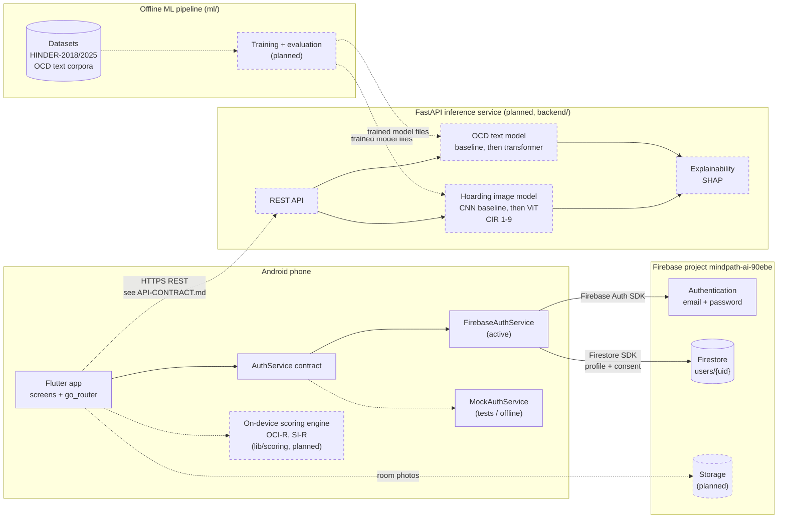
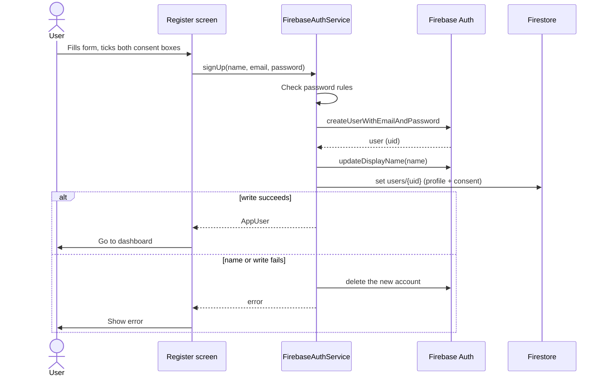

# MindPath AI - System architecture

How the parts of MindPath AI fit together. Each part is marked **built** or **planned**,
based on the code as of 2026-10-27.

MindPath AI gives preliminary screening and self-support for OCD and Hoarding Disorder. It
is not a diagnostic tool.

## System diagram

Solid lines and boxes are built. Dashed lines and boxes are planned and not built yet.

## Components

### Flutter app (built, in progress)

Android app in `lib/`.

| Part | Where | Status |
|---|---|---|
| Design system: colours, type, spacing, shared widgets | `lib/theme/`, `lib/widgets/`, `DESIGN.md` | Built |
| Routing with a sign-in guard | `lib/routes/app_router.dart` | Built. Signed-out users are sent to Welcome from any non-public route. |
| Auth screens: Login, Register (with consent), Forgot password | `lib/screens/` | Built |
| Auth contract | `lib/services/auth_service.dart` | Built. Screens depend only on this. |
| `FirebaseAuthService` | `lib/services/firebase_auth_service.dart` | Built, active in `lib/app.dart` |
| `MockAuthService` | `lib/services/mock_auth_service.dart` | Built, used by tests |
| Dashboard | `lib/screens/home_screen.dart` | UI built; check-in count and mood are not saved |
| Assessment ("Keep or let go") and Report | `lib/screens/assessment_screen.dart`, `report_screen.dart` | UI with sample data only |
| Therapy, Progress, History, Chat, Profile | `lib/screens/` | Placeholder screens |
| On-device scoring for OCI-R and SI-R | `lib/scoring/` | Planned; folder is empty |

The scoring engine is meant to run on the phone so the validated instrument score works
offline. The AI models add a second layer on top when the backend is reachable.

### Firebase (built: Auth and Firestore)

| Service | Used for | Status |
|---|---|---|
| Authentication | Email and password accounts, sessions, password reset email | Built |
| Firestore | `users/{uid}`: profile and consent record. See `DATABASE-SCHEMA.md`. | Built |
| Firestore rules | Each user can read and write only their own data (`firestore.rules`) | Deployed |
| Storage | Planned in the stack. Not a dependency in `pubspec.yaml` yet. | Planned |

The app talks to Firebase directly through the FlutterFire SDKs (`firebase_core`,
`firebase_auth`, `cloud_firestore`). There is no server between the app and Firebase.

### FastAPI inference service (planned)

`backend/` is empty. The service is needed because the models use PyTorch, scikit-learn
and SHAP, which cannot run inside Flutter.

Planned responsibilities, from the module plan:

| Module | What the service will do |
|---|---|
| 5, 7 | Rate a room photo for clutter on the HINDER Clutter Image Rating scale (1 to 9). Baseline CNN first, then a ViT. |
| 6, 8 | Classify user text for OCD-related language. Baseline classifier first, then a transformer. Classes come from the corpora in `docs/DATA.md` (`ocd`, `other_condition`, and `control` in the 3-class set). |
| 9 | Explain each model output (SHAP) and build the assessment report. |

The planned endpoints are in `API-CONTRACT.md`.

### Offline ML pipeline (in progress)

Lives in `ml/` and runs on a laptop or Colab, not in the app.

| Part | Status |
|---|---|
| Download and preparation scripts (`ml/scripts/`) | Built |
| OCD text corpora (`ml/data/ocd_corpus_*.csv`) | Built; documented in `docs/DATA.md` |
| HINDER-2018 and HINDER-2025 images | Extracted into `ml/data/hinder-*`; exploratory analysis in `ml/eda/` |
| Training, evaluation, exported models | Planned |

`ml/data/` is git-ignored.

## Flows

### Registration (built)

### Login (built)

1. The Login screen calls `AuthService.signIn`.
2. `FirebaseAuthService` calls Firebase Auth. A wrong email or password is turned into the
   same error type the mock uses, so the screen shows one generic message.
3. After 5 failures in a row the Login screen locks for 30 seconds (`LoginThrottle`).
   Firebase also applies its own server-side limit.
4. On success, the router's sign-in guard lets the user into the app.

On app start, `FirebaseAuthService` restores the previous session from Firebase Auth.

### Screening (planned)

From `PRODUCT.md`:

1. The user picks a condition and completes the instrument (OCI-R or SI-R) and any tasks.
2. The phone scores the instrument itself. This works offline.
3. If the backend is reachable, the app sends AI inputs (room photos for hoarding, text for
   OCD) to the inference service.
4. The report shows the instrument score first and the AI result as an explained second
   layer, always labelled "preliminary screening, not a medical diagnosis".

## Open decisions

These are not decided in the code or design yet:

- How the app proves its identity to the FastAPI service.
- Whether room photos go to Firebase Storage first or straight to the backend.
- Where the backend will be hosted.
- Whether the backend reads or writes Firestore, or only returns results to the app.
