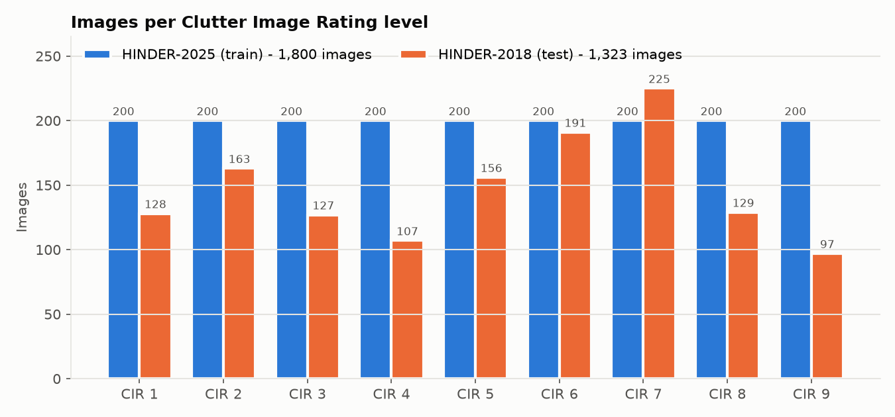
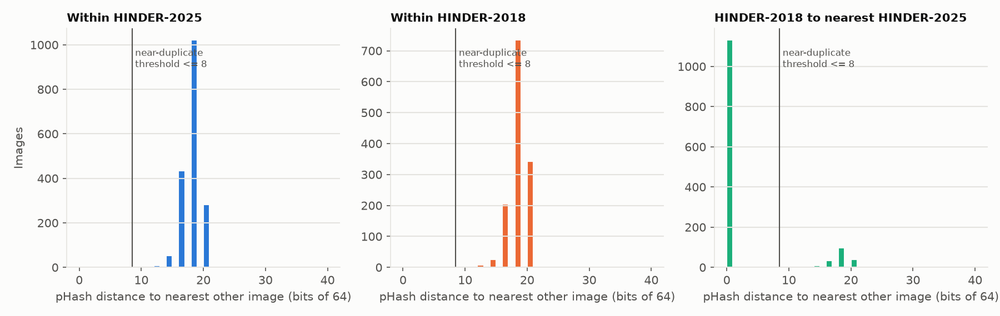
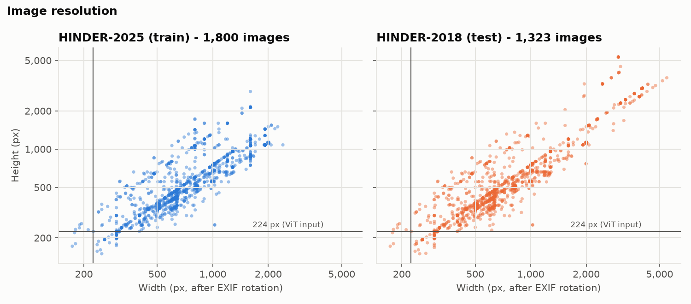
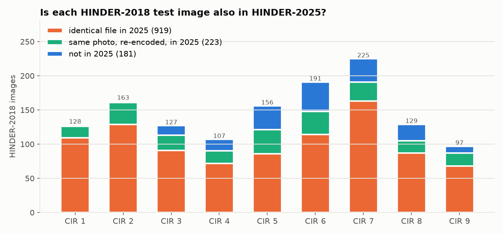
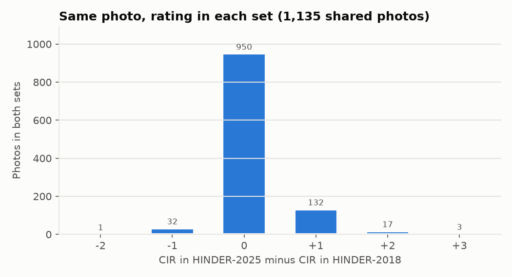

# MindPath AI - Data

How the training data for the two AI modules was sourced, labelled, cleaned and checked,
and what its known limitations are. All data lives under `ml/data/`, which is
git-ignored; this file and the scripts in `ml/scripts/` and `ml/eda/` are the record of
how to rebuild it.

Both modules are **preliminary screening** aids, not diagnostic tools. Nothing in this
data carries a clinical diagnosis of the people involved.

- [OCD text data](#ocd-text-data) - Reddit corpora for the OCD text model
- [Hoarding image data (HINDER)](#hoarding-image-data-hinder) - clutter photos for the hoarding image model
- [Dataset inventory](#dataset-inventory) - every file under `ml/data/`

## OCD text data

How the text corpora for the OCD linguistic module were sourced, labelled, cleaned and
balanced. Nothing in these corpora carries a clinical diagnosis (see *Labelling method*).

### Corpora

| File | Classes | Rows per class | Total | Role |
|---|---|---|---|---|
| `ml/data/ocd_corpus_2class.csv` | ocd, other_condition | 24,395 | 48,790 | **Primary corpus for the thesis** |
| `ml/data/ocd_corpus_2class_sample.csv` | ocd, other_condition | 8,000 | 16,000 | Quick iteration on Colab free tier |
| `ml/data/ocd_corpus_3class.csv` | ocd, other_condition, control | 24,395 | 73,185 | Secondary, for the app's "no indication" path |

Columns in every file: `post_id`, `label`, `text`, `word_count`, `source_subreddit`.

Class composition:

| Corpus | Class | Source subreddits (rows) | Mean / median words |
|---|---|---|---|
| 2-class | ocd | r/OCD 24,395 | 170.5 / 116 |
| 2-class | other_condition | r/ADHD 8,323, r/ptsd 5,436, r/depression 5,331, r/aspergers 5,305 | 199.9 / 142 |
| 2-class sample | ocd | r/OCD 8,000 | 169.4 / 117 |
| 2-class sample | other_condition | r/ADHD 2,741, r/depression 1,757, r/ptsd 1,756, r/aspergers 1,746 | 199.1 / 142 |
| 3-class | ocd, other_condition | identical rows to the 2-class corpus | as above |
| 3-class | control | r/personalfinance 12,661, r/fitness 11,734 | 147.7 / 115 |

The `ocd` and `other_condition` rows are the same posts in the 2-class and 3-class files;
only the row order differs. The sample is a strict subset of the 2-class corpus. All
sampling uses seed 42.

### Sources

#### 1. Reddit mental health posts (Hugging Face) - `ocd` and `other_condition`

- **Dataset:** `solomonk/reddit_mental_health_posts`
- **URL:** https://huggingface.co/datasets/solomonk/reddit_mental_health_posts
- **Licence:** unstated. The dataset card names no licence and no collection method
  beyond pointing to PRAW's submission fields. Re-use is also subject to Reddit's terms.
- **Fetched by:** `ml/scripts/download_extras.py` (no account needed)
- **Contents:** one CSV per subreddit with `author, body, created_utc, id, num_comments,
  score, subreddit, title, upvote_ratio, url`. The `author` column is removed before use.

| File | Rows | Dropped as [removed] / [deleted] / empty | Date range (UTC) |
|---|---|---|---|
| ocd.csv | 42,826 | 17,180 | 2021-02-16 to 2021-12-22 |
| adhd.csv | 37,109 | 16,711 | 2021-10-01 to 2021-12-22 |
| aspergers.csv | 23,294 | 9,841 | 2021-01-11 to 2021-12-23 |
| depression.csv | 24,031 | 10,147 | 2021-11-06 to 2021-12-23 |
| ptsd.csv | 24,028 | 10,333 | 2019-07-07 to 2021-12-23 |

The Reddit API is not reachable from Pakistan, so this archive replaces the originally
planned self-collected r/OCD corpus. It is the only public corpus found with an OCD class.

#### 2. Reddit Mental Health Dataset (Zenodo) - `control`

- **Dataset:** Reddit Mental Health Dataset, Zenodo record 3941387
- **URL:** https://zenodo.org/records/3941387
- **Licence:** ODC Public Domain Dedication and Licence (ODC-PDDL) 1.0. Re-use is also
  subject to Reddit's terms.
- **Cite:** Low, D. M., Rumker, L., Talkar, T., Torous, J., Cecchi, G., & Ghosh, S. S.
  (2020). Natural language processing reveals vulnerable mental health support groups
  and heightened health anxiety on Reddit during COVID-19: Observational study.
  *Journal of Medical Internet Research, 22*(10), e22635. https://doi.org/10.2196/22635
- **Fetched by:** `ml/scripts/download_datasets.py` (MD5-verified against the record)
- **Used here:** `fitness_pre_features_tfidf_256.csv` (22,164 rows, 2018-11-01 to
  2019-11-01) and `personalfinance_pre_features_tfidf_256.csv` (23,440 rows, 2018-11-08 to
  2019-10-27). Only the `post` column (title and body already joined) and `subreddit` are
  read; `author` and the precomputed features are never loaded. These files have no post
  ID, so `post_id` is built from subreddit and row number.

The other nine Zenodo files downloaded by the same script (anxiety, depression, ptsd,
bipolar, adhd, autism, socialanxiety, EDAnonymous, suicidewatch) are not used in these
corpora.

### Labelling method

**Distant supervision via subreddit membership.** A post's label is the community it was
posted in: r/OCD is `ocd`; r/ADHD, r/aspergers, r/depression and r/ptsd together are
`other_condition`; r/fitness and r/personalfinance are `control`. No post was annotated
by a person, and posting in r/OCD does not mean the author has OCD: posters include
people who suspect it, relatives and partners, and people asking general questions. The
labels mean "posted in this community", and results must be reported that way.

### Cleaning

Applied by `ml/scripts/prepare_ocd_corpus.py`, in this order, identically to every class:

1. **Text** is `title + "\n" + body` (Hugging Face) or `post` (Zenodo, already joined).
2. **Dead posts dropped:** body or title `[removed]`, `[deleted]` or empty.
3. **Curly apostrophes normalised** to `'`, so the patterns below also catch `I’m` and `Asperger’s`.
4. **Links:** markdown links are replaced by their link text, then bare URLs are removed.
5. **Mentions:** `u/username` and `r/subreddit` are removed.
6. **Self-report phrases removed**, for every condition in the corpus (OCD and its
   subtypes such as ROCD and HOCD, ADHD, PTSD, Asperger's / autism, depression, anxiety):
   "I was / I've been diagnosed with X", "diagnosed with X", "X diagnosis", "I have /
   suffer from / struggle with X", "my X", "people with X", "X sufferer", "I'm autistic",
   "my therapist / psychiatrist / doctor said / told me / thinks", and condition-free
   self-reports such as "I was diagnosed as having", "I've had the diagnosis",
   "got diagnosed" and "self-diagnosed".
7. **Bare condition names removed:** any remaining OCD (and subtypes),
   obsessive-compulsive, ADHD, PTSD / C-PTSD, Asperger's, aspie, autism, autistic,
   depression. `depressed` is kept, because it describes a mood rather than naming a class.
8. **Short posts dropped:** under 20 words after cleaning (2,857 posts).
9. **Duplicates dropped:** identical text or identical post ID (170 posts).
10. **No identifier columns:** `author`, `username`, `user`, `author_fullname` and `name`
    are never carried into the output; the script asserts this.
11. **Balancing:** each corpus is downsampled to its smallest class. `ocd` is the
    smallest (24,395 usable posts of 42,826), so 24,395 posts are drawn from the 59,976
    available `other_condition` posts and from the 45,282 available `control` posts.

Steps 6 and 7 are essential. Without them a model learns to spot "I have OCD" or the
word "OCD" itself, and the reported accuracy measures that phrase rather than anything
about how people with OCD write.

Residual check on the final corpora: no post contains an OCD, ADHD or PTSD label, a
u/ or r/ mention, or a URL. Word forms the patterns do not cover survive in a few posts:
"obsessive-compulsiveness" (3 `ocd` posts) and "autistics", "aspergic", "aspergians"
(73 posts, 72 of them `other_condition`).

### Known limitations

#### 1. Source confound affecting the `control` class

`ocd` and `other_condition` come from the Hugging Face archive (2019-2021, mostly 2021);
`control` comes from Zenodo (2018-2019), a different collection with a different
pipeline. A model can separate `control` by recognising which corpus a post came from
rather than anything about OCD. The `control` class is also topically trivial to
separate (its most distinctive words are pay, money, weight, credit, car, gym, debt).

**Consequence:** the 2-class corpus is the primary corpus, and any 3-class result must
report `ocd` vs `other_condition` performance separately. Accuracy on `control` is not
evidence of OCD screening ability.

#### 2. Community topic words mark the subreddit, not the condition

After cleaning, no class is identified by a condition name, but each community still has
its own vocabulary. In the 2-class corpus the most distinctive `other_condition` words
include **adderall, meds, mg** (ADHD medication talk in r/ADHD), **trauma, abuse**
(r/ptsd), and work, job, school, college, focus. The model can learn "talks about
stimulant doses" or "talks about abuse" as "not OCD". This is a property of distant
supervision by subreddit and cannot be removed by cleaning alone.

The most distinctive `ocd` words are thoughts, intrusive, fear, compulsions, obsession(s),
checking, hands, real. These are genuine OCD symptom language (intrusive thoughts,
checking and washing compulsions, "what if it's real" doubt), so they were kept; but
"intrusive thoughts" and "compulsions" are also r/OCD's community vocabulary. A model that
relies on them is matching how r/OCD talks about OCD, which may not transfer to users
who do not use that vocabulary.

**Suggested checks for the thesis:** report the top features or SHAP attributions of the
trained model; evaluate with these words masked as an ablation; and report per-subreddit
error within `other_condition`, since an uneven mix (r/ADHD is 34% of the class) can hide
a weak pairing.

#### Further caveats

- **Time spread within the Hugging Face archive.** r/ADHD and r/depression posts are all
  from Oct-Dec 2021, 55% of r/ptsd posts are from before 2021, and r/OCD spans Feb-Dec
  2021. This is the same collection and format, so it is far weaker than limitation 1,
  and no time-specific words appear among the distinctive words; it is still a possible
  shortcut through period-specific topics.
- **Length difference.** `other_condition` posts are longer (median 142 words against
  116 for `ocd`). Report whether the model's errors correlate with length.
- **Selection by survival.** 40% of r/OCD posts were removed or deleted and are excluded,
  so the corpus over-represents posts that moderators and authors left up.
- **Licence.** The Hugging Face archive states no licence. It is used for academic
  research only and is not redistributed; this must be recorded as a limitation.

### Rebuilding

```
pip install -r ml/requirements.txt
python ml/scripts/download_datasets.py --out ml/data/reddit_mental_health
python ml/scripts/download_extras.py --out ml/data/extras
python ml/scripts/prepare_ocd_corpus.py
```

`prepare_ocd_corpus.py` is deterministic for a given seed (default 42) and prints the
row counts and the fifteen most distinctive words per class for every run.

## Hoarding image data (HINDER)

Room photos rated on the nine-point Clutter Image Rating (CIR) scale, for the hoarding
image model (Modules 5 and 7).

**Final split (decided 2026-10-27):** all 1,323 HINDER-2018 images are the held-out
cross-dataset test set, and the 659 HINDER-2025 images that share no photo with
HINDER-2018 are the training set. The split is grouped by duplicate group, not by file.
The 659 training images are further split into 527 train and 132 validation, stratified
by CIR level and grouped the same way. The test label is the original HINDER-2018 rating.
See *Train/test split* and *Train/validation split*. The analysis below explains why:
86% of HINDER-2018 photos are also in HINDER-2025.

All numbers in this section come from `ml/eda/hinder_eda.py` and
`ml/scripts/make_hinder_split.py` (run on 2026-10-27). The analysis output is in
`ml/eda/output/` (`summary.json` holds every figure quoted here); the split is
`ml/splits/hinder_split.csv`.

### Image sets

| Folder | Images | Per CIR level | Size | Role |
|---|---|---|---|---|
| `ml/data/hinder-2025/` | 1,800 | 200 each (balanced) | 469.8 MB | Training: the 659 images not shared with HINDER-2018 |
| `ml/data/hinder-2018/` | 1,323 | 97 to 225 (unbalanced) | 552.8 MB | Cross-dataset test: all images |

Layout: `CIR <level>/CIR_<level>_<photo id>.jpg`, levels 1 to 9. Every file name matches
this pattern, the level in each name matches its folder, and no photo ID repeats within a
set. The same photo keeps the same photo ID in both sets.

HINDER-2018 per level:

| CIR | 1 | 2 | 3 | 4 | 5 | 6 | 7 | 8 | 9 |
|---|---|---|---|---|---|---|---|---|---|
| Images | 128 | 163 | 127 | 107 | 156 | 191 | 225 | 129 | 97 |



### Source

- **Dataset:** 2025 Hoarding and INDoor cluttER (HINDER) Dataset, which includes
  HINDER-2018
- **URL:** https://vip.bu.edu/projects/social/hoarding-2025-dataset (Boston University
  Visual Information Processing lab)
- **Access:** download form on the page above. Downloaded manually as `HINDER-2025.zip`
  and `HINDER-2018.zip`; neither zip contains a licence or README file.
- **Licence:** the page states "You may use this dataset for non-commercial purposes."
  It does not address redistribution, so the images are not redistributed (see
  *Further caveats*).
- **Cite:** Z. Sun, J. Muroff, and J. Konrad, "Classification of indoor clutter from
  images: Application to hoarding assessment," in *33rd European Signal Processing
  Conference (EUSIPCO-2025)*, Palermo, Italy, Sept. 2025.
- **Relation of the two sets, per the page:** HINDER-2025 "expanded the HINDER-2018
  dataset" to 200 images per CIR class, "a 36% increase over the 2018 dataset". The page
  does not say how many 2018 images were kept; this analysis measured it.

### Labelling method

Each image carries one CIR level, 1 (no clutter) to 9 (severe clutter), given by its
folder. The CIR is a published pictorial scale for rating clutter in a room (Frost,
Steketee, Tolin & Renaud, 2008, *Journal of Psychopathology and Behavioral Assessment*).

The dataset page says "each image must be rated by a health professional to assign a CIR
value", and separately thanks Boston University students "for their help in collecting
and rating images". Who rated each image, and how many raters each image had, is not
stated. Describe the labels as "CIR ratings supplied with the dataset", not as
clinician ratings, unless the authors confirm it.

The labels rate the clutter in one photo of one room. They say nothing about the person
who lives there.

### Checks run

`ml/eda/hinder_eda.py` fully decodes every file (Pillow, with EXIF orientation applied)
and records:

1. **Readability:** decode errors and decoder warnings
2. **Format:** actual format and colour mode, whatever the file extension says
3. **Resolution:** width and height after EXIF rotation
4. **Exact duplicates:** identical SHA-256 of the file bytes
5. **Near duplicates:** 64-bit perceptual hash (`imagehash.phash`); two images at a
   Hamming distance of 8 bits or less count as the same photo
6. **Cross-set overlap:** for each HINDER-2018 image, whether HINDER-2025 has the same
   bytes, the same photo ID, or a near duplicate, and whether the CIR level agrees

**Why 8 bits.** Every HINDER-2018 image's nearest HINDER-2025 image is either 0 to 6
bits away or at least 10, with most unrelated images 14 to 20 bits apart. 8 sits in that
gap. All pairs at 2 to 6 bits whose photo IDs differ were checked by eye
(`images_check_pairs.png`); each is the same scene with small colour or crop changes.



### Findings

**Readability and format.** No file in either set is unreadable or raises a decoder
warning.

| | HINDER-2025 | HINDER-2018 |
|---|---|---|
| JPEG | 1,798 | 1,315 |
| MPO (multi-picture JPEG; decodes as JPEG) | 2 | 5 |
| PNG with `.jpg` extension (RGBA) | 0 | 2 (`CIR 5/CIR_5_86ffffd0.jpg`, `CIR_5_8eb55db3.jpg`) |
| GIF with `.jpg` extension (palette) | 0 | 1 (`CIR 5/CIR_5_d1bdf52b.jpg`) |
| Colour mode | all RGB | 1,320 RGB, 2 RGBA, 1 palette |
| EXIF orientation tag | none | 1 (`CIR 2/CIR_2_ca37910e.jpg`) |

`CIR_2_ca37910e.jpg` in HINDER-2018 is wrongly oriented: with its EXIF tag applied the
kitchen is upside down, without it the kitchen is sideways. The HINDER-2025 copy of the
same photo is upright.

**Resolution.** Sizes vary widely in both sets (804 and 866 distinct resolutions).

| | HINDER-2025 | HINDER-2018 |
|---|---|---|
| Shorter side, median (5th to 95th percentile) | 736 px (253 to 1,200) | 480 px (226 to 2,448) |
| Largest image | 2,400 x 2,844 | 5,472 wide |
| Shorter side under 224 px | 36 | 48 |
| Shorter side under 384 px | 383 | 454 |
| Landscape / portrait / square | 1,574 / 206 / 20 | 1,132 / 171 / 20 |



**Duplicates within each set.** HINDER-2025 has no exact or near duplicates. HINDER-2018
has no exact duplicates and one near-duplicate pair: `CIR 8/CIR_8_c62b01dd.jpg` and
`CIR 8/CIR_8_e62b0145.jpg`, the same room with different colour, both rated 8.

**Overlap between the sets.** 1,135 of the 1,323 HINDER-2018 photos (86%) also appear in
HINDER-2025 under the same photo ID, so 63% of HINDER-2025 consists of HINDER-2018
photos. Seven more HINDER-2018 photos match a HINDER-2025 photo by pHash under a slightly
different ID (listed in `summary.json`).

| HINDER-2018 image, compared with HINDER-2025 | Images | Share |
|---|---|---|
| Identical file (same bytes) | 919 | 69.5% |
| Same photo, re-encoded (same ID or pHash within 8 bits) | 223 | 16.9% |
| Not in HINDER-2025 | 181 | 13.7% |

The 181 independent HINDER-2018 images by CIR level:

| CIR | 1 | 2 | 3 | 4 | 5 | 6 | 7 | 8 | 9 |
|---|---|---|---|---|---|---|---|---|---|
| Independent images | 2 | 2 | 14 | 17 | 35 | 43 | 34 | 24 | 10 |



**Ratings that changed between the sets.** Of the 1,135 photos in both sets, 185 (16.3%)
have a different CIR level in HINDER-2025. Most moved up by one level.

| CIR in 2025 minus CIR in 2018 | -2 | -1 | 0 | +1 | +2 | +3 |
|---|---|---|---|---|---|---|
| Photos | 1 | 32 | 950 | 132 | 17 | 3 |



**Seen in the sample grids, not measured.** Some images carry watermarks or caption
text, some are letterboxed with black bars, and some show people. The grids
(`images_samples_hinder-2025.png`, `images_samples_hinder-2018.png`) show five random
images from CIR 1, 3, 5, 7 and 9, seed 42.

### Train/test split

**Final.** Built by `ml/scripts/make_hinder_split.py`, written to
`ml/splits/hinder_split.csv`. This file is the only definition of the test set, and
`hinder_train_val_split.csv` (see *Train/validation split*) the only definition of train
and validation. Training and evaluation code must read these files rather than list the
image folders.

| Split | Source | Images | Duplicate groups | Per CIR level |
|---|---|---|---|---|
| train | HINDER-2025, photos not in HINDER-2018 | 659 | 659 | 33 to 123 |
| test | HINDER-2018, all images | 1,323 | 1,322 | 97 to 225 |
| dropped | HINDER-2025 copies of test photos | 1,141 | n/a | n/a |

| CIR | 1 | 2 | 3 | 4 | 5 | 6 | 7 | 8 | 9 |
|---|---|---|---|---|---|---|---|---|---|
| train | 82 | 53 | 87 | 123 | 50 | 45 | 33 | 100 | 86 |
| test | 128 | 163 | 127 | 107 | 156 | 191 | 225 | 129 | 97 |

**How it is built.** Every image of both sets goes into a duplicate group. Two images are
in the same group if they share a photo ID, have identical bytes, or have pHashes within 8
bits, applied transitively. A group containing any HINDER-2018 image goes to test; every
other group goes to train. The HINDER-2025 images in test groups are dropped, so no photo
is in both splits and no duplicate group is split across them.

The 1,142 HINDER-2018 images with a copy in HINDER-2025 (919 identical files and 223
re-encoded copies, see *Findings*) remove 1,141 HINDER-2025 images, not 1,142. One
HINDER-2025 photo (`CIR_8_c62b01dd.jpg`) is the copy of both images in HINDER-2018's own
near-duplicate pair, which form one group.

**Checks.** The script stops if any of these fails:

- every HINDER-2018 image is in test, and train holds only HINDER-2025 images
- no duplicate group, photo ID or file hash appears in both splits
- the closest train-test pair is more than 8 pHash bits apart (on this split it is 10)
- every file exists with the size recorded in the manifest

**Why this split.**

- **No leakage.** Testing on HINDER-2018 after training on all of HINDER-2025 would score
  the model mostly on photos it was trained on (86% overlap). Grouping by duplicate group,
  not by file, also keeps re-encoded and slightly edited copies out of training.
- **A test set usable at every CIR level.** All nine levels have 97 to 225 test images.
  The alternative, testing only on the 181 HINDER-2018 photos that are not in HINDER-2025,
  has 2 images each at CIR 1 and 2, too few to report anything at those levels.
- **Cost.** Training shrinks from 1,800 to 659 images and is no longer balanced (see
  *Known limitations*, 1).

**Columns** of `hinder_split.csv`:

| Column | Meaning |
|---|---|
| `split` | `train` or `test` |
| `set` | `hinder-2025` or `hinder-2018` |
| `cir` | CIR level from the image's own set. **Primary label** for training and testing; for test images this is the original HINDER-2018 rating. |
| `cir_2025` | Test images only: the same photo's level in HINDER-2025, if it is there. **Secondary**, for a sensitivity analysis only (see *Known limitations*, 2). |
| `file` | Path under `ml/data/` |
| `photo_id` | ID from the file name |
| `group_id` | Smallest photo ID in the duplicate group |
| `group_size` | Images in the group across both sets, including dropped copies |

**Test label (decided 2026-10-27).** The primary test label is `cir`, the original
HINDER-2018 rating, for comparability with the EUSIPCO-2025 baseline (Sun, Muroff &
Konrad). `cir_2025` is kept only as a secondary column for a sensitivity analysis. Before
comparing numbers directly with the paper, check that it reports results on the same
images with the same labels.

### Train/validation split

**Final.** Built by `ml/scripts/make_hinder_val_split.py` from the training rows of
`ml/splits/hinder_split.csv`, written to `ml/splits/hinder_train_val_split.csv`. Test
images are not read into it and never move.

| Split | Images | Duplicate groups | Per CIR level |
|---|---|---|---|
| train | 527 | 527 | 26 to 98 |
| val | 132 | 132 | 7 to 25 |
| total (training images of the train/test split) | 659 | 659 | 33 to 123 |

| CIR | 1 | 2 | 3 | 4 | 5 | 6 | 7 | 8 | 9 |
|---|---|---|---|---|---|---|---|---|---|
| train | 66 | 42 | 70 | 98 | 40 | 36 | 26 | 80 | 69 |
| val | 16 | 11 | 17 | 25 | 10 | 9 | 7 | 20 | 17 |

**How it is built.** Validation is 20% of each CIR level (`--val-frac 0.2`, seed 42),
rounded to the nearest image. The unit moved is the duplicate group (`group_id`, the same
groups as the train/test split), never a single file. Each group is assigned to the level
most of its images have; within a level, groups are shuffled with the seed and moved to
validation until the level reaches its target. HINDER-2025 has no near duplicates within
itself, so every training group currently holds one image and the split is effectively
per image; the grouping still protects it if the data changes.

**Checks.** The script stops if any of these fails:

- train and validation together hold exactly the 659 training images
- no `group_id` appears in both train and validation
- no train or validation group also appears in the test set
- every CIR level has at least one validation image

**Why this split.**

- **Model selection without touching the test set.** Hyperparameters, early stopping and
  checkpoint choice use validation only, so the HINDER-2018 test result stays a clean
  cross-dataset measure.
- **Stratified by level,** so validation has the same level mix as training despite the
  imbalance (33 to 123 per level).
- **Grouped,** so a re-encoded or edited copy of a photo can never sit on both sides.
- **20%** keeps at least 7 validation images at the smallest level (CIR 7) while leaving
  527 for training. A larger share would take too much from levels that are already small.

**Columns** of `hinder_train_val_split.csv`:

| Column | Meaning |
|---|---|
| `split` | `train` or `val` |
| `set` | always `hinder-2025` |
| `cir` | CIR level, the label to train and validate on |
| `file` | Path under `ml/data/` |
| `photo_id` | ID from the file name |
| `group_id` | Same duplicate group as in `hinder_split.csv` |

### Known limitations

#### 1. Small, unbalanced training set

The final split leaves 659 training images, from 33 (CIR 7) to 123 (CIR 4) per level,
because the photos removed for overlapping with HINDER-2018 were spread unevenly across
levels. After the validation split, 527 remain for fitting (26 at CIR 7). Expect to need a pretrained backbone, augmentation, and class weights or
resampling. Report per-level results and macro averages, not only overall accuracy.

#### 2. Label drift between labelling rounds

The same photo does not always keep its rating between the 2018 and 2025 releases: 185 of
the 1,135 photos in both sets (16.3%) have a different CIR level in 2025, mostly one level
higher (132 up by one, 17 up by two, 3 up by three, 33 down). The dataset does not
explain why.

This matters twice in this split:

- **Train and test labels come from different rounds.** Training uses 2025 ratings; the
  test set uses the original 2018 ratings. If the 2025 round rated slightly higher, a
  model trained on it can look biased upward on the 2018 test set even when it is right
  by 2025 standards.
- **185 test images carry a label the dataset itself later changed.** Their primary label
  stays the 2018 rating (`cir`). As a sensitivity analysis, report the test results a
  second time with `cir_2025` in place of `cir` for these 185 images, and report how much
  the metrics move. Report the bias as the mean signed error (prediction minus label).

A one-level disagreement between rating rounds is common, so also report mean absolute
error and within-one-level accuracy alongside exact accuracy.

#### Further caveats

- **Resolution shift.** HINDER-2018 photos are smaller at the median (480 px shorter side
  against 736) but include much larger camera originals (up to 5,472 px wide). Resizing to
  a fixed input such as 224 px removes most of that difference, but 36 HINDER-2025 and 48
  HINDER-2018 images are smaller than 224 px and must be upscaled.
- **Format quirks.** Three HINDER-2018 files are PNG or GIF despite the `.jpg` extension.
  Loaders must open by content, not extension, and convert every image to RGB. Apply EXIF
  orientation consistently; `CIR_2_ca37910e.jpg` is wrong either way.
- **Unbalanced test levels.** The test set is unbalanced (97 to 225 per level), so report
  per-level and macro-averaged results.
- **Duplicate pair in the test set.** `CIR 8/CIR_8_c62b01dd.jpg` and `CIR_8_e62b0145.jpg`
  are the same room and both stay in test (one group). Image-level metrics count it twice,
  group-level metrics once; the difference is one image in 1,323.
- **Small validation levels.** Validation has 7 to 25 images per level (7 at CIR 7), so
  per-level validation scores are noisy. Select models on macro-averaged or overall
  validation metrics, not on a single level.
- **Visual artefacts and people.** Watermarks, captions, letterboxing and people appear
  in some images (seen, not counted). A model may pick up on these instead of clutter.
- **Who rated the images** is not documented (see *Labelling method*).
- **Licence.** The dataset is licensed for non-commercial use only and its page says
  nothing about redistribution. The images are not redistributed: `ml/data/` and the
  sample-image outputs (`ml/eda/output/images_*.png`) are git-ignored. `PRODUCT.md` plans
  a release to real users after the FYP; check with the dataset authors before shipping a
  model trained on HINDER in a public app.

### Rebuilding

```
pip install -r ml/requirements.txt
unzip "<downloads>/HINDER-2025.zip" -x "*desktop.ini" -d ml/data/hinder-2025
unzip "<downloads>/HINDER-2018.zip" -x "*desktop.ini" -d ml/data/hinder-2018
python ml/eda/hinder_eda.py
python ml/scripts/make_hinder_split.py
python ml/scripts/make_hinder_val_split.py
```

Both zips contain one Google Drive `desktop.ini` per class folder. These are not images
and were deleted after extraction. The analysis is deterministic (sample grids use seed
42) and takes about 20 seconds with 8 worker processes. The split script reads
`ml/eda/output/manifest.csv`; the validation script reads `ml/splits/hinder_split.csv`.
Both are deterministic: re-running them produces byte-identical CSVs.

## Dataset inventory

Scanned on 2026-10-25; HINDER rows and total disk usage updated 2026-10-27. Sizes are file sizes in MB (10^6 bytes). Row counts are parsed CSV
records (a post with line breaks counts once), excluding the header. ⚠ marks a file that
still has an `author` column.

### Presence checks

| Item | Status |
|---|---|
| `ml/data/hinder-2025/`, 9 class subfolders | Present (extracted 2026-10-27), 1,800 images, 200 per class. See *Hoarding image data (HINDER)*. |
| `ml/data/hinder-2018/`, 9 class subfolders | Present (extracted 2026-10-27), 1,323 images, 97 to 225 per class |
| `ml/data/reddit_mental_health/`, 11 CSVs | Present, 11 of 11, MD5-verified against Zenodo |
| `ml/data/extras/reddit_mental_health_posts/ocd_clean.csv` | Present, 42,826 rows, no `author` column |
| `ml/data/ocd_corpus_2class.csv` and `ocd_corpus_3class.csv` | Present, 48,790 and 73,185 rows |
| `ml/data/extras/mendeley_suicide/` | **Missing.** Needs a browser download from https://data.mendeley.com/datasets/z8s6w86tr3/2 |

### Checks

| Check | Result |
|---|---|
| No column named `author`, `username` or `user` under `ml/data/` | **Fails: 235 of 473 CSVs have `author`.** All are raw source files (below). None of the derived files has one: every `*_clean.csv` and all three `ocd_corpus_*` files pass. No file has `username` or `user`. |
| `ml/data/` is in `.gitignore` | Passes (`.gitignore` line 51: `ml/data/`) |
| Total disk usage of `ml/data/` | 5,214,682,091 bytes = 5.21 GB (4.9 GiB): 473 CSVs, 3,123 HINDER images, 100 Roboflow images and metadata |

Files that still contain `author`:

| Folder | Files | Size | Note |
|---|---|---|---|
| `ml/data/reddit_mental_health/` | 11 | 424.6 MB | Original Zenodo files. Only `post` and `subreddit` are read when the corpora are built. |
| `ml/data/extras/reddit_mental_health_posts/` | 5 (`adhd`, `aspergers`, `depression`, `ocd`, `ptsd`.csv) | 114.0 MB | Raw originals; a `*_clean.csv` without `author` sits beside each. |
| `ml/data/extras/reddit-mental-health-dataset/raw data/` | 219 | 1,651.9 MB | Raw originals; a `*_clean.csv` without `author` sits beside each. |

### Summary by folder

| Folder | CSVs | Size | Rows |
|---|---|---|---|
| `ml/data` | 3 | 136.3 MB | 137,975 |
| `ml/data/extras/depression-reddit-cleaned` | 1 | 2.8 MB | 7,731 |
| `ml/data/extras/Mental-Health_Text-Classification_Dataset` | 3 | 50.1 MB | 100,216 |
| `ml/data/extras/reddit-mental-health-data` | 1 | 5.1 MB | 5,957 |
| `ml/data/extras/reddit-mental-health-dataset` | 442 | 3,281.5 MB | 3,703,983 |
| `ml/data/extras/reddit_mental_health_posts` | 10 | 226.4 MB | 302,576 |
| `ml/data/extras/sentiment-analysis-for-mental-health` | 1 | 31.5 MB | 53,043 |
| `ml/data/extras/stress-and-anxiety-posts-on-reddit` | 1 | 3.5 MB | 3,999 |
| `ml/data/reddit_mental_health` | 11 | 424.6 MB | 154,432 |
| **Total** | **473** | **4,161.7 MB** | **4,469,912** |

Non-CSV data: `ml/data/hinder-2025/` and `ml/data/hinder-2018/` hold the HINDER images (see above). `ml/data/roboflow/` holds the Roboflow "Clean Vs Messy Room" set (100 JPGs, CC BY 4.0;
train 35+35, valid 10+10, test 5+5, Clean+Messy). Each folder also has its README or `SOURCES*.md`.

### Every CSV

| Folder | File | Size | Rows |
|---|---|---|---|
| `ml/data` | `ocd_corpus_2class.csv` | 49.7 MB | 48,790 |
| `ml/data` | `ocd_corpus_2class_sample.csv` | 16.2 MB | 16,000 |
| `ml/data` | `ocd_corpus_3class.csv` | 70.4 MB | 73,185 |
| `ml/data/extras/depression-reddit-cleaned` | `depression_dataset_reddit_cleaned.csv` | 2.8 MB | 7,731 |
| `ml/data/extras/Mental-Health_Text-Classification_Dataset` | `mental_health_combined_test.csv` | 0.8 MB | 992 |
| `ml/data/extras/Mental-Health_Text-Classification_Dataset` | `mental_health_feature_engineered.csv` | 28.5 MB | 49,612 |
| `ml/data/extras/Mental-Health_Text-Classification_Dataset` | `mental_heath_unbanlanced.csv` | 20.8 MB | 49,612 |
| `ml/data/extras/reddit-mental-health-data` | `data_to_be_cleansed.csv` | 5.1 MB | 5,957 |
| `ml/data/extras/reddit_mental_health_posts` | `adhd.csv` | 29.6 MB | 37,109 ⚠ `author` |
| `ml/data/extras/reddit_mental_health_posts` | `adhd_clean.csv` | 29.2 MB | 37,109 |
| `ml/data/extras/reddit_mental_health_posts` | `aspergers.csv` | 17.3 MB | 23,294 ⚠ `author` |
| `ml/data/extras/reddit_mental_health_posts` | `aspergers_clean.csv` | 17.1 MB | 23,294 |
| `ml/data/extras/reddit_mental_health_posts` | `depression.csv` | 17.2 MB | 24,031 ⚠ `author` |
| `ml/data/extras/reddit_mental_health_posts` | `depression_clean.csv` | 16.9 MB | 24,031 |
| `ml/data/extras/reddit_mental_health_posts` | `ocd.csv` | 29.8 MB | 42,826 ⚠ `author` |
| `ml/data/extras/reddit_mental_health_posts` | `ocd_clean.csv` | 29.4 MB | 42,826 |
| `ml/data/extras/reddit_mental_health_posts` | `ptsd.csv` | 20.1 MB | 24,028 ⚠ `author` |
| `ml/data/extras/reddit_mental_health_posts` | `ptsd_clean.csv` | 19.8 MB | 24,028 |
| `ml/data/extras/sentiment-analysis-for-mental-health` | `Combined Data.csv` | 31.5 MB | 53,043 |
| `ml/data/extras/stress-and-anxiety-posts-on-reddit` | `stressed_anxious_cleaned.csv` | 3.5 MB | 3,999 |
| `ml/data/reddit_mental_health` | `adhd_pre_features_tfidf_256.csv` | 47.3 MB | 16,696 ⚠ `author` |
| `ml/data/reddit_mental_health` | `anxiety_pre_features_tfidf_256.csv` | 56.7 MB | 19,976 ⚠ `author` |
| `ml/data/reddit_mental_health` | `autism_pre_features_tfidf_256.csv` | 12.6 MB | 4,576 ⚠ `author` |
| `ml/data/reddit_mental_health` | `bipolarreddit_pre_features_tfidf_256.csv` | 7.8 MB | 2,720 ⚠ `author` |
| `ml/data/reddit_mental_health` | `depression_pre_features_tfidf_256.csv` | 60.5 MB | 21,209 ⚠ `author` |
| `ml/data/reddit_mental_health` | `EDAnonymous_pre_features_tfidf_256.csv` | 17.3 MB | 6,947 ⚠ `author` |
| `ml/data/reddit_mental_health` | `fitness_pre_features_tfidf_256.csv` | 54.6 MB | 22,164 ⚠ `author` |
| `ml/data/reddit_mental_health` | `personalfinance_pre_features_tfidf_256.csv` | 63.5 MB | 23,440 ⚠ `author` |
| `ml/data/reddit_mental_health` | `ptsd_pre_features_tfidf_256.csv` | 14.0 MB | 4,483 ⚠ `author` |
| `ml/data/reddit_mental_health` | `socialanxiety_pre_features_tfidf_256.csv` | 34.2 MB | 12,277 ⚠ `author` |
| `ml/data/reddit_mental_health` | `suicidewatch_pre_features_tfidf_256.csv` | 56.1 MB | 19,944 ⚠ `author` |

<details><summary><code>ml/data/extras/reddit-mental-health-dataset/</code>: 442 CSVs (the Rani et al. 2024 corpus: 4 labelled files, 219 raw monthly files and their 219 <code>_clean</code> copies)</summary>

| Folder | File | Size | Rows |
|---|---|---|---|
| `ml/data/extras/reddit-mental-health-dataset/Original Reddit Data/Labelled Data` | `LD DA 1.csv` | 0.2 MB | 223 |
| `ml/data/extras/reddit-mental-health-dataset/Original Reddit Data/Labelled Data` | `LD EL1.csv` | 0.4 MB | 200 |
| `ml/data/extras/reddit-mental-health-dataset/Original Reddit Data/Labelled Data` | `LD PF1.csv` | 0.2 MB | 200 |
| `ml/data/extras/reddit-mental-health-dataset/Original Reddit Data/Labelled Data` | `LD TS 1.csv` | 0.3 MB | 200 |
| `ml/data/extras/reddit-mental-health-dataset/Original Reddit Data/raw data/2019/apr` | `anxapr19.csv` | 4.5 MB | 4,663 ⚠ `author` |
| `ml/data/extras/reddit-mental-health-dataset/Original Reddit Data/raw data/2019/apr` | `anxapr19_clean.csv` | 4.5 MB | 4,663 |
| `ml/data/extras/reddit-mental-health-dataset/Original Reddit Data/raw data/2019/apr` | `depapr19.csv` | 13.8 MB | 14,277 ⚠ `author` |
| `ml/data/extras/reddit-mental-health-dataset/Original Reddit Data/raw data/2019/apr` | `depapr19_clean.csv` | 13.7 MB | 14,277 |
| `ml/data/extras/reddit-mental-health-dataset/Original Reddit Data/raw data/2019/apr` | `loneapr19.csv` | 1.0 MB | 1,188 ⚠ `author` |
| `ml/data/extras/reddit-mental-health-dataset/Original Reddit Data/raw data/2019/apr` | `loneapr19_clean.csv` | 1.0 MB | 1,188 |
| `ml/data/extras/reddit-mental-health-dataset/Original Reddit Data/raw data/2019/apr` | `mentalhealthapr19.csv` | 4.5 MB | 3,500 ⚠ `author` |
| `ml/data/extras/reddit-mental-health-dataset/Original Reddit Data/raw data/2019/apr` | `mentalhealthapr19_clean.csv` | 4.5 MB | 3,500 |
| `ml/data/extras/reddit-mental-health-dataset/Original Reddit Data/raw data/2019/apr` | `swapr19.csv` | 5.6 MB | 6,018 ⚠ `author` |
| `ml/data/extras/reddit-mental-health-dataset/Original Reddit Data/raw data/2019/apr` | `swapr19_clean.csv` | 5.6 MB | 6,018 |
| `ml/data/extras/reddit-mental-health-dataset/Original Reddit Data/raw data/2019/Aug` | `anipjaug19.csv` | 4.9 MB | 5,394 ⚠ `author` |
| `ml/data/extras/reddit-mental-health-dataset/Original Reddit Data/raw data/2019/Aug` | `anipjaug19_clean.csv` | 4.9 MB | 5,394 |
| `ml/data/extras/reddit-mental-health-dataset/Original Reddit Data/raw data/2019/Aug` | `depjaug19.csv` | 14.6 MB | 15,320 ⚠ `author` |
| `ml/data/extras/reddit-mental-health-dataset/Original Reddit Data/raw data/2019/Aug` | `depjaug19_clean.csv` | 14.5 MB | 15,320 |
| `ml/data/extras/reddit-mental-health-dataset/Original Reddit Data/raw data/2019/Aug` | `lonaug19.csv` | 1.7 MB | 2,110 ⚠ `author` |
| `ml/data/extras/reddit-mental-health-dataset/Original Reddit Data/raw data/2019/Aug` | `lonaug19_clean.csv` | 1.7 MB | 2,110 |
| `ml/data/extras/reddit-mental-health-dataset/Original Reddit Data/raw data/2019/Aug` | `mhaug19.csv` | 4.9 MB | 3,644 ⚠ `author` |
| `ml/data/extras/reddit-mental-health-dataset/Original Reddit Data/raw data/2019/Aug` | `mhaug19_clean.csv` | 4.8 MB | 3,644 |
| `ml/data/extras/reddit-mental-health-dataset/Original Reddit Data/raw data/2019/Aug` | `swaug19.csv` | 6.8 MB | 7,327 ⚠ `author` |
| `ml/data/extras/reddit-mental-health-dataset/Original Reddit Data/raw data/2019/Aug` | `swaug19_clean.csv` | 6.7 MB | 7,327 |
| `ml/data/extras/reddit-mental-health-dataset/Original Reddit Data/raw data/2019/dec` | `anidec19.csv` | 4.6 MB | 4,921 ⚠ `author` |
| `ml/data/extras/reddit-mental-health-dataset/Original Reddit Data/raw data/2019/dec` | `anidec19_clean.csv` | 4.5 MB | 4,921 |
| `ml/data/extras/reddit-mental-health-dataset/Original Reddit Data/raw data/2019/dec` | `depdec19.csv` | 7.2 MB | 7,964 ⚠ `author` |
| `ml/data/extras/reddit-mental-health-dataset/Original Reddit Data/raw data/2019/dec` | `depdec19_clean.csv` | 7.1 MB | 7,964 |
| `ml/data/extras/reddit-mental-health-dataset/Original Reddit Data/raw data/2019/dec` | `lonedec19.csv` | 2.3 MB | 2,906 ⚠ `author` |
| `ml/data/extras/reddit-mental-health-dataset/Original Reddit Data/raw data/2019/dec` | `lonedec19_clean.csv` | 2.3 MB | 2,906 |
| `ml/data/extras/reddit-mental-health-dataset/Original Reddit Data/raw data/2019/dec` | `mhdec19.csv` | 5.3 MB | 4,350 ⚠ `author` |
| `ml/data/extras/reddit-mental-health-dataset/Original Reddit Data/raw data/2019/dec` | `mhdec19_clean.csv` | 5.3 MB | 4,350 |
| `ml/data/extras/reddit-mental-health-dataset/Original Reddit Data/raw data/2019/dec` | `swdec19.csv` | 7.2 MB | 7,964 ⚠ `author` |
| `ml/data/extras/reddit-mental-health-dataset/Original Reddit Data/raw data/2019/dec` | `swdec19_clean.csv` | 7.1 MB | 7,964 |
| `ml/data/extras/reddit-mental-health-dataset/Original Reddit Data/raw data/2019/feb` | `anifeb19.csv` | 4.3 MB | 4,582 ⚠ `author` |
| `ml/data/extras/reddit-mental-health-dataset/Original Reddit Data/raw data/2019/feb` | `anifeb19_clean.csv` | 4.2 MB | 4,582 |
| `ml/data/extras/reddit-mental-health-dataset/Original Reddit Data/raw data/2019/feb` | `depfeb19.csv` | 12.3 MB | 12,535 ⚠ `author` |
| `ml/data/extras/reddit-mental-health-dataset/Original Reddit Data/raw data/2019/feb` | `depfeb19_clean.csv` | 12.1 MB | 12,535 |
| `ml/data/extras/reddit-mental-health-dataset/Original Reddit Data/raw data/2019/feb` | `lonfeb19.csv` | 0.8 MB | 1,041 ⚠ `author` |
| `ml/data/extras/reddit-mental-health-dataset/Original Reddit Data/raw data/2019/feb` | `lonfeb19_clean.csv` | 0.8 MB | 1,041 |
| `ml/data/extras/reddit-mental-health-dataset/Original Reddit Data/raw data/2019/feb` | `mhfeb19.csv` | 4.3 MB | 3,248 ⚠ `author` |
| `ml/data/extras/reddit-mental-health-dataset/Original Reddit Data/raw data/2019/feb` | `mhfeb19_clean.csv` | 4.2 MB | 3,248 |
| `ml/data/extras/reddit-mental-health-dataset/Original Reddit Data/raw data/2019/feb` | `Swfeb19.csv` | 4.9 MB | 5,097 ⚠ `author` |
| `ml/data/extras/reddit-mental-health-dataset/Original Reddit Data/raw data/2019/feb` | `Swfeb19_clean.csv` | 4.8 MB | 5,097 |
| `ml/data/extras/reddit-mental-health-dataset/Original Reddit Data/raw data/2019/JAN` | `anijan19.csv` | 4.8 MB | 5,219 ⚠ `author` |
| `ml/data/extras/reddit-mental-health-dataset/Original Reddit Data/raw data/2019/JAN` | `anijan19_clean.csv` | 4.7 MB | 5,219 |
| `ml/data/extras/reddit-mental-health-dataset/Original Reddit Data/raw data/2019/JAN` | `depjan19.csv` | 12.3 MB | 12,818 ⚠ `author` |
| `ml/data/extras/reddit-mental-health-dataset/Original Reddit Data/raw data/2019/JAN` | `depjan19_clean.csv` | 12.1 MB | 12,818 |
| `ml/data/extras/reddit-mental-health-dataset/Original Reddit Data/raw data/2019/JAN` | `lonejan19.csv` | 0.9 MB | 1,076 ⚠ `author` |
| `ml/data/extras/reddit-mental-health-dataset/Original Reddit Data/raw data/2019/JAN` | `lonejan19_clean.csv` | 0.9 MB | 1,076 |
| `ml/data/extras/reddit-mental-health-dataset/Original Reddit Data/raw data/2019/JAN` | `mhjan22.csv` | 4.2 MB | 3,116 ⚠ `author` |
| `ml/data/extras/reddit-mental-health-dataset/Original Reddit Data/raw data/2019/JAN` | `mhjan22_clean.csv` | 4.1 MB | 3,116 |
| `ml/data/extras/reddit-mental-health-dataset/Original Reddit Data/raw data/2019/JAN` | `swjun19.csv` | 5.2 MB | 5,529 ⚠ `author` |
| `ml/data/extras/reddit-mental-health-dataset/Original Reddit Data/raw data/2019/JAN` | `swjun19_clean.csv` | 5.2 MB | 5,529 |
| `ml/data/extras/reddit-mental-health-dataset/Original Reddit Data/raw data/2019/jul` | `anijul19.csv` | 5.2 MB | 5,279 ⚠ `author` |
| `ml/data/extras/reddit-mental-health-dataset/Original Reddit Data/raw data/2019/jul` | `anijul19_clean.csv` | 5.1 MB | 5,279 |
| `ml/data/extras/reddit-mental-health-dataset/Original Reddit Data/raw data/2019/jul` | `depjul19.csv` | 15.4 MB | 15,705 ⚠ `author` |
| `ml/data/extras/reddit-mental-health-dataset/Original Reddit Data/raw data/2019/jul` | `depjul19_clean.csv` | 15.2 MB | 15,705 |
| `ml/data/extras/reddit-mental-health-dataset/Original Reddit Data/raw data/2019/jul` | `lonejul19.csv` | 1.6 MB | 1,937 ⚠ `author` |
| `ml/data/extras/reddit-mental-health-dataset/Original Reddit Data/raw data/2019/jul` | `lonejul19_clean.csv` | 1.5 MB | 1,937 |
| `ml/data/extras/reddit-mental-health-dataset/Original Reddit Data/raw data/2019/jul` | `mhjul19.csv` | 4.3 MB | 3,309 ⚠ `author` |
| `ml/data/extras/reddit-mental-health-dataset/Original Reddit Data/raw data/2019/jul` | `mhjul19_clean.csv` | 4.2 MB | 3,309 |
| `ml/data/extras/reddit-mental-health-dataset/Original Reddit Data/raw data/2019/jul` | `swjul19.csv` | 6.8 MB | 7,312 ⚠ `author` |
| `ml/data/extras/reddit-mental-health-dataset/Original Reddit Data/raw data/2019/jul` | `swjul19_clean.csv` | 6.7 MB | 7,312 |
| `ml/data/extras/reddit-mental-health-dataset/Original Reddit Data/raw data/2019/june` | `anijun19.csv` | 4.5 MB | 4,738 ⚠ `author` |
| `ml/data/extras/reddit-mental-health-dataset/Original Reddit Data/raw data/2019/june` | `anijun19_clean.csv` | 4.4 MB | 4,738 |
| `ml/data/extras/reddit-mental-health-dataset/Original Reddit Data/raw data/2019/june` | `depjun19.csv` | 14.4 MB | 14,912 ⚠ `author` |
| `ml/data/extras/reddit-mental-health-dataset/Original Reddit Data/raw data/2019/june` | `depjun19_clean.csv` | 14.2 MB | 14,912 |
| `ml/data/extras/reddit-mental-health-dataset/Original Reddit Data/raw data/2019/june` | `lonejun19.csv` | 1.3 MB | 1,582 ⚠ `author` |
| `ml/data/extras/reddit-mental-health-dataset/Original Reddit Data/raw data/2019/june` | `lonejun19_clean.csv` | 1.3 MB | 1,582 |
| `ml/data/extras/reddit-mental-health-dataset/Original Reddit Data/raw data/2019/june` | `mhjun19.csv` | 4.7 MB | 3,632 ⚠ `author` |
| `ml/data/extras/reddit-mental-health-dataset/Original Reddit Data/raw data/2019/june` | `mhjun19_clean.csv` | 4.6 MB | 3,632 |
| `ml/data/extras/reddit-mental-health-dataset/Original Reddit Data/raw data/2019/june` | `swjun19.csv` | 6.2 MB | 6,651 ⚠ `author` |
| `ml/data/extras/reddit-mental-health-dataset/Original Reddit Data/raw data/2019/june` | `swjun19_clean.csv` | 6.1 MB | 6,651 |
| `ml/data/extras/reddit-mental-health-dataset/Original Reddit Data/raw data/2019/mar` | `anxmar19.csv` | 4.9 MB | 5,149 ⚠ `author` |
| `ml/data/extras/reddit-mental-health-dataset/Original Reddit Data/raw data/2019/mar` | `anxmar19_clean.csv` | 4.8 MB | 5,149 |
| `ml/data/extras/reddit-mental-health-dataset/Original Reddit Data/raw data/2019/mar` | `depmar19.csv` | 14.3 MB | 14,513 ⚠ `author` |
| `ml/data/extras/reddit-mental-health-dataset/Original Reddit Data/raw data/2019/mar` | `depmar19_clean.csv` | 14.2 MB | 14,513 |
| `ml/data/extras/reddit-mental-health-dataset/Original Reddit Data/raw data/2019/mar` | `lonmar19.csv` | 0.8 MB | 1,011 ⚠ `author` |
| `ml/data/extras/reddit-mental-health-dataset/Original Reddit Data/raw data/2019/mar` | `lonmar19_clean.csv` | 0.8 MB | 1,011 |
| `ml/data/extras/reddit-mental-health-dataset/Original Reddit Data/raw data/2019/mar` | `mhmar19.csv` | 4.7 MB | 3,568 ⚠ `author` |
| `ml/data/extras/reddit-mental-health-dataset/Original Reddit Data/raw data/2019/mar` | `mhmar19_clean.csv` | 4.7 MB | 3,568 |
| `ml/data/extras/reddit-mental-health-dataset/Original Reddit Data/raw data/2019/mar` | `swmar19.csv` | 5.5 MB | 5,877 ⚠ `author` |
| `ml/data/extras/reddit-mental-health-dataset/Original Reddit Data/raw data/2019/mar` | `swmar19_clean.csv` | 5.4 MB | 5,877 |
| `ml/data/extras/reddit-mental-health-dataset/Original Reddit Data/raw data/2019/MAy` | `animay19.csv` | 4.5 MB | 4,809 ⚠ `author` |
| `ml/data/extras/reddit-mental-health-dataset/Original Reddit Data/raw data/2019/MAy` | `animay19_clean.csv` | 4.5 MB | 4,809 |
| `ml/data/extras/reddit-mental-health-dataset/Original Reddit Data/raw data/2019/MAy` | `depamay19.csv` | 14.5 MB | 14,806 ⚠ `author` |
| `ml/data/extras/reddit-mental-health-dataset/Original Reddit Data/raw data/2019/MAy` | `depamay19_clean.csv` | 14.3 MB | 14,806 |
| `ml/data/extras/reddit-mental-health-dataset/Original Reddit Data/raw data/2019/MAy` | `lonemay19.csv` | 1.1 MB | 1,315 ⚠ `author` |
| `ml/data/extras/reddit-mental-health-dataset/Original Reddit Data/raw data/2019/MAy` | `lonemay19_clean.csv` | 1.1 MB | 1,315 |
| `ml/data/extras/reddit-mental-health-dataset/Original Reddit Data/raw data/2019/MAy` | `mhmay19.csv` | 5.0 MB | 3,915 ⚠ `author` |
| `ml/data/extras/reddit-mental-health-dataset/Original Reddit Data/raw data/2019/MAy` | `mhmay19_clean.csv` | 4.9 MB | 3,915 |
| `ml/data/extras/reddit-mental-health-dataset/Original Reddit Data/raw data/2019/MAy` | `swmay19.csv` | 5.9 MB | 6,326 ⚠ `author` |
| `ml/data/extras/reddit-mental-health-dataset/Original Reddit Data/raw data/2019/MAy` | `swmay19_clean.csv` | 5.8 MB | 6,326 |
| `ml/data/extras/reddit-mental-health-dataset/Original Reddit Data/raw data/2019/nov` | `aninov19.csv` | 4.4 MB | 4,767 ⚠ `author` |
| `ml/data/extras/reddit-mental-health-dataset/Original Reddit Data/raw data/2019/nov` | `aninov19_clean.csv` | 4.3 MB | 4,767 |
| `ml/data/extras/reddit-mental-health-dataset/Original Reddit Data/raw data/2019/nov` | `lonnov19.csv` | 1.9 MB | 2,567 ⚠ `author` |
| `ml/data/extras/reddit-mental-health-dataset/Original Reddit Data/raw data/2019/nov` | `lonnov19_clean.csv` | 1.9 MB | 2,567 |
| `ml/data/extras/reddit-mental-health-dataset/Original Reddit Data/raw data/2019/nov` | `mhnov19.csv` | 5.3 MB | 4,246 ⚠ `author` |
| `ml/data/extras/reddit-mental-health-dataset/Original Reddit Data/raw data/2019/nov` | `mhnov19_clean.csv` | 5.3 MB | 4,246 |
| `ml/data/extras/reddit-mental-health-dataset/Original Reddit Data/raw data/2019/nov` | `sdepnov19.csv` | 15.9 MB | 17,284 ⚠ `author` |
| `ml/data/extras/reddit-mental-health-dataset/Original Reddit Data/raw data/2019/nov` | `sdepnov19_clean.csv` | 15.7 MB | 17,284 |
| `ml/data/extras/reddit-mental-health-dataset/Original Reddit Data/raw data/2019/nov` | `swnov19.csv` | 6.6 MB | 7,386 ⚠ `author` |
| `ml/data/extras/reddit-mental-health-dataset/Original Reddit Data/raw data/2019/nov` | `swnov19_clean.csv` | 6.5 MB | 7,386 |
| `ml/data/extras/reddit-mental-health-dataset/Original Reddit Data/raw data/2019/oct` | `anioct19.csv` | 4.8 MB | 5,102 ⚠ `author` |
| `ml/data/extras/reddit-mental-health-dataset/Original Reddit Data/raw data/2019/oct` | `anioct19_clean.csv` | 4.7 MB | 5,102 |
| `ml/data/extras/reddit-mental-health-dataset/Original Reddit Data/raw data/2019/oct` | `depoct19.csv` | 16.6 MB | 17,798 ⚠ `author` |
| `ml/data/extras/reddit-mental-health-dataset/Original Reddit Data/raw data/2019/oct` | `depoct19_clean.csv` | 16.4 MB | 17,798 |
| `ml/data/extras/reddit-mental-health-dataset/Original Reddit Data/raw data/2019/oct` | `lonoct19.csv` | 1.9 MB | 2,382 ⚠ `author` |
| `ml/data/extras/reddit-mental-health-dataset/Original Reddit Data/raw data/2019/oct` | `lonoct19_clean.csv` | 1.8 MB | 2,382 |
| `ml/data/extras/reddit-mental-health-dataset/Original Reddit Data/raw data/2019/oct` | `mhoct19.csv` | 5.6 MB | 4,408 ⚠ `author` |
| `ml/data/extras/reddit-mental-health-dataset/Original Reddit Data/raw data/2019/oct` | `mhoct19_clean.csv` | 5.5 MB | 4,408 |
| `ml/data/extras/reddit-mental-health-dataset/Original Reddit Data/raw data/2019/oct` | `swsoct19.csv` | 6.9 MB | 7,578 ⚠ `author` |
| `ml/data/extras/reddit-mental-health-dataset/Original Reddit Data/raw data/2019/oct` | `swsoct19_clean.csv` | 6.8 MB | 7,578 |
| `ml/data/extras/reddit-mental-health-dataset/Original Reddit Data/raw data/2019/sep` | `anisep19.csv` | 4.7 MB | 5,085 ⚠ `author` |
| `ml/data/extras/reddit-mental-health-dataset/Original Reddit Data/raw data/2019/sep` | `anisep19_clean.csv` | 4.7 MB | 5,085 |
| `ml/data/extras/reddit-mental-health-dataset/Original Reddit Data/raw data/2019/sep` | `depasep19.csv` | 15.1 MB | 15,782 ⚠ `author` |
| `ml/data/extras/reddit-mental-health-dataset/Original Reddit Data/raw data/2019/sep` | `depasep19_clean.csv` | 14.9 MB | 15,782 |
| `ml/data/extras/reddit-mental-health-dataset/Original Reddit Data/raw data/2019/sep` | `lonasep19.csv` | 1.7 MB | 2,142 ⚠ `author` |
| `ml/data/extras/reddit-mental-health-dataset/Original Reddit Data/raw data/2019/sep` | `lonasep19_clean.csv` | 1.7 MB | 2,142 |
| `ml/data/extras/reddit-mental-health-dataset/Original Reddit Data/raw data/2019/sep` | `mhsep19.csv` | 4.9 MB | 3,863 ⚠ `author` |
| `ml/data/extras/reddit-mental-health-dataset/Original Reddit Data/raw data/2019/sep` | `mhsep19_clean.csv` | 4.9 MB | 3,863 |
| `ml/data/extras/reddit-mental-health-dataset/Original Reddit Data/raw data/2019/sep` | `swsep19.csv` | 6.6 MB | 7,192 ⚠ `author` |
| `ml/data/extras/reddit-mental-health-dataset/Original Reddit Data/raw data/2019/sep` | `swsep19_clean.csv` | 6.5 MB | 7,192 |
| `ml/data/extras/reddit-mental-health-dataset/Original Reddit Data/raw data/2020/Apr 20` | `anxiapr20.csv` | 5.4 MB | 5,771 ⚠ `author` |
| `ml/data/extras/reddit-mental-health-dataset/Original Reddit Data/raw data/2020/Apr 20` | `anxiapr20_clean.csv` | 5.3 MB | 5,771 |
| `ml/data/extras/reddit-mental-health-dataset/Original Reddit Data/raw data/2020/Apr 20` | `depapr20.csv` | 13.1 MB | 14,355 ⚠ `author` |
| `ml/data/extras/reddit-mental-health-dataset/Original Reddit Data/raw data/2020/Apr 20` | `depapr20_clean.csv` | 13.0 MB | 14,355 |
| `ml/data/extras/reddit-mental-health-dataset/Original Reddit Data/raw data/2020/Apr 20` | `loneapr20.csv` | 2.3 MB | 3,021 ⚠ `author` |
| `ml/data/extras/reddit-mental-health-dataset/Original Reddit Data/raw data/2020/Apr 20` | `loneapr20_clean.csv` | 2.3 MB | 3,021 |
| `ml/data/extras/reddit-mental-health-dataset/Original Reddit Data/raw data/2020/Apr 20` | `Mhapr20.csv` | 6.1 MB | 5,034 ⚠ `author` |
| `ml/data/extras/reddit-mental-health-dataset/Original Reddit Data/raw data/2020/Apr 20` | `Mhapr20_clean.csv` | 6.1 MB | 5,034 |
| `ml/data/extras/reddit-mental-health-dataset/Original Reddit Data/raw data/2020/Apr 20` | `Swapr20.csv` | 7.9 MB | 9,011 ⚠ `author` |
| `ml/data/extras/reddit-mental-health-dataset/Original Reddit Data/raw data/2020/Apr 20` | `Swapr20_clean.csv` | 7.8 MB | 9,011 |
| `ml/data/extras/reddit-mental-health-dataset/Original Reddit Data/raw data/2020/Aug 20` | `anxiaug20.csv` | 6.4 MB | 6,767 ⚠ `author` |
| `ml/data/extras/reddit-mental-health-dataset/Original Reddit Data/raw data/2020/Aug 20` | `anxiaug20_clean.csv` | 6.3 MB | 6,767 |
| `ml/data/extras/reddit-mental-health-dataset/Original Reddit Data/raw data/2020/Aug 20` | `depaug20.csv` | 12.9 MB | 14,344 ⚠ `author` |
| `ml/data/extras/reddit-mental-health-dataset/Original Reddit Data/raw data/2020/Aug 20` | `depaug20_clean.csv` | 12.7 MB | 14,344 |
| `ml/data/extras/reddit-mental-health-dataset/Original Reddit Data/raw data/2020/Aug 20` | `loneaug20.csv` | 2.4 MB | 3,213 ⚠ `author` |
| `ml/data/extras/reddit-mental-health-dataset/Original Reddit Data/raw data/2020/Aug 20` | `loneaug20_clean.csv` | 2.4 MB | 3,213 |
| `ml/data/extras/reddit-mental-health-dataset/Original Reddit Data/raw data/2020/Aug 20` | `Mheaug20.csv` | 7.2 MB | 6,524 ⚠ `author` |
| `ml/data/extras/reddit-mental-health-dataset/Original Reddit Data/raw data/2020/Aug 20` | `Mheaug20_clean.csv` | 7.1 MB | 6,524 |
| `ml/data/extras/reddit-mental-health-dataset/Original Reddit Data/raw data/2020/Aug 20` | `Swaug20 copy.csv` | 8.9 MB | 10,721 ⚠ `author` |
| `ml/data/extras/reddit-mental-health-dataset/Original Reddit Data/raw data/2020/Aug 20` | `Swaug20 copy_clean.csv` | 8.8 MB | 10,721 |
| `ml/data/extras/reddit-mental-health-dataset/Original Reddit Data/raw data/2020/Dec 20` | `anxietydec20.csv` | 6.8 MB | 7,552 ⚠ `author` |
| `ml/data/extras/reddit-mental-health-dataset/Original Reddit Data/raw data/2020/Dec 20` | `anxietydec20_clean.csv` | 6.7 MB | 7,552 |
| `ml/data/extras/reddit-mental-health-dataset/Original Reddit Data/raw data/2020/Dec 20` | `depdec20.csv` | 16.7 MB | 19,266 ⚠ `author` |
| `ml/data/extras/reddit-mental-health-dataset/Original Reddit Data/raw data/2020/Dec 20` | `depdec20_clean.csv` | 16.5 MB | 19,266 |
| `ml/data/extras/reddit-mental-health-dataset/Original Reddit Data/raw data/2020/Dec 20` | `lonedec20.csv` | 2.7 MB | 4,496 ⚠ `author` |
| `ml/data/extras/reddit-mental-health-dataset/Original Reddit Data/raw data/2020/Dec 20` | `lonedec20_clean.csv` | 2.6 MB | 4,496 |
| `ml/data/extras/reddit-mental-health-dataset/Original Reddit Data/raw data/2020/Dec 20` | `Mhdec20.csv` | 11.1 MB | 8,786 ⚠ `author` |
| `ml/data/extras/reddit-mental-health-dataset/Original Reddit Data/raw data/2020/Dec 20` | `Mhdec20_clean.csv` | 11.0 MB | 8,786 |
| `ml/data/extras/reddit-mental-health-dataset/Original Reddit Data/raw data/2020/Dec 20` | `Swdec20.csv` | 12.4 MB | 15,502 ⚠ `author` |
| `ml/data/extras/reddit-mental-health-dataset/Original Reddit Data/raw data/2020/Dec 20` | `Swdec20_clean.csv` | 12.2 MB | 15,502 |
| `ml/data/extras/reddit-mental-health-dataset/Original Reddit Data/raw data/2020/Feb20` | `anxifeb20.csv` | 5.0 MB | 5,426 ⚠ `author` |
| `ml/data/extras/reddit-mental-health-dataset/Original Reddit Data/raw data/2020/Feb20` | `anxifeb20_clean.csv` | 5.0 MB | 5,426 |
| `ml/data/extras/reddit-mental-health-dataset/Original Reddit Data/raw data/2020/Feb20` | `depfeb20.csv` | 14.9 MB | 16,400 ⚠ `author` |
| `ml/data/extras/reddit-mental-health-dataset/Original Reddit Data/raw data/2020/Feb20` | `depfeb20_clean.csv` | 14.7 MB | 16,400 |
| `ml/data/extras/reddit-mental-health-dataset/Original Reddit Data/raw data/2020/Feb20` | `lonefeb20.csv` | 2.3 MB | 3,189 ⚠ `author` |
| `ml/data/extras/reddit-mental-health-dataset/Original Reddit Data/raw data/2020/Feb20` | `lonefeb20_clean.csv` | 2.2 MB | 3,189 |
| `ml/data/extras/reddit-mental-health-dataset/Original Reddit Data/raw data/2020/Feb20` | `Mhfeb20.csv` | 5.8 MB | 4,505 ⚠ `author` |
| `ml/data/extras/reddit-mental-health-dataset/Original Reddit Data/raw data/2020/Feb20` | `Mhfeb20_clean.csv` | 5.7 MB | 4,505 |
| `ml/data/extras/reddit-mental-health-dataset/Original Reddit Data/raw data/2020/Feb20` | `swfeb20.csv` | 7.8 MB | 8,522 ⚠ `author` |
| `ml/data/extras/reddit-mental-health-dataset/Original Reddit Data/raw data/2020/Feb20` | `swfeb20_clean.csv` | 7.7 MB | 8,522 |
| `ml/data/extras/reddit-mental-health-dataset/Original Reddit Data/raw data/2020/Jan 20` | `anxijan20.csv` | 5.3 MB | 5,750 ⚠ `author` |
| `ml/data/extras/reddit-mental-health-dataset/Original Reddit Data/raw data/2020/Jan 20` | `anxijan20_clean.csv` | 5.2 MB | 5,750 |
| `ml/data/extras/reddit-mental-health-dataset/Original Reddit Data/raw data/2020/Jan 20` | `depjan20 .csv` | 16.4 MB | 17,516 ⚠ `author` |
| `ml/data/extras/reddit-mental-health-dataset/Original Reddit Data/raw data/2020/Jan 20` | `depjan20 _clean.csv` | 16.2 MB | 17,516 |
| `ml/data/extras/reddit-mental-health-dataset/Original Reddit Data/raw data/2020/Jan 20` | `lonejan20.csv` | 2.2 MB | 3,061 ⚠ `author` |
| `ml/data/extras/reddit-mental-health-dataset/Original Reddit Data/raw data/2020/Jan 20` | `lonejan20_clean.csv` | 2.1 MB | 3,061 |
| `ml/data/extras/reddit-mental-health-dataset/Original Reddit Data/raw data/2020/Jan 20` | `Mhjan20.csv` | 5.9 MB | 4,700 ⚠ `author` |
| `ml/data/extras/reddit-mental-health-dataset/Original Reddit Data/raw data/2020/Jan 20` | `Mhjan20_clean.csv` | 5.8 MB | 4,700 |
| `ml/data/extras/reddit-mental-health-dataset/Original Reddit Data/raw data/2020/Jan 20` | `SWjan20.csv` | 7.4 MB | 8,161 ⚠ `author` |
| `ml/data/extras/reddit-mental-health-dataset/Original Reddit Data/raw data/2020/Jan 20` | `SWjan20_clean.csv` | 7.3 MB | 8,161 |
| `ml/data/extras/reddit-mental-health-dataset/Original Reddit Data/raw data/2020/Jul 20` | `anxijul20.csv` | 6.2 MB | 6,696 ⚠ `author` |
| `ml/data/extras/reddit-mental-health-dataset/Original Reddit Data/raw data/2020/Jul 20` | `anxijul20_clean.csv` | 6.1 MB | 6,696 |
| `ml/data/extras/reddit-mental-health-dataset/Original Reddit Data/raw data/2020/Jul 20` | `depjul20.csv` | 13.8 MB | 15,780 ⚠ `author` |
| `ml/data/extras/reddit-mental-health-dataset/Original Reddit Data/raw data/2020/Jul 20` | `depjul20_clean.csv` | 13.6 MB | 15,780 |
| `ml/data/extras/reddit-mental-health-dataset/Original Reddit Data/raw data/2020/Jul 20` | `lonejul20.csv` | 2.5 MB | 3,345 ⚠ `author` |
| `ml/data/extras/reddit-mental-health-dataset/Original Reddit Data/raw data/2020/Jul 20` | `lonejul20_clean.csv` | 2.4 MB | 3,345 |
| `ml/data/extras/reddit-mental-health-dataset/Original Reddit Data/raw data/2020/Jul 20` | `MHjul20.csv` | 7.0 MB | 6,559 ⚠ `author` |
| `ml/data/extras/reddit-mental-health-dataset/Original Reddit Data/raw data/2020/Jul 20` | `MHjul20_clean.csv` | 6.9 MB | 6,559 |
| `ml/data/extras/reddit-mental-health-dataset/Original Reddit Data/raw data/2020/Jul 20` | `Swjul20.csv` | 8.8 MB | 11,166 ⚠ `author` |
| `ml/data/extras/reddit-mental-health-dataset/Original Reddit Data/raw data/2020/Jul 20` | `Swjul20_clean.csv` | 8.7 MB | 11,166 |
| `ml/data/extras/reddit-mental-health-dataset/Original Reddit Data/raw data/2020/June 20` | `anxijun20.csv` | 6.1 MB | 6,521 ⚠ `author` |
| `ml/data/extras/reddit-mental-health-dataset/Original Reddit Data/raw data/2020/June 20` | `anxijun20_clean.csv` | 6.0 MB | 6,521 |
| `ml/data/extras/reddit-mental-health-dataset/Original Reddit Data/raw data/2020/June 20` | `depjun20.csv` | 13.6 MB | 15,462 ⚠ `author` |
| `ml/data/extras/reddit-mental-health-dataset/Original Reddit Data/raw data/2020/June 20` | `depjun20_clean.csv` | 13.4 MB | 15,462 |
| `ml/data/extras/reddit-mental-health-dataset/Original Reddit Data/raw data/2020/June 20` | `lonejun20.csv` | 2.3 MB | 2,956 ⚠ `author` |
| `ml/data/extras/reddit-mental-health-dataset/Original Reddit Data/raw data/2020/June 20` | `lonejun20_clean.csv` | 2.2 MB | 2,956 |
| `ml/data/extras/reddit-mental-health-dataset/Original Reddit Data/raw data/2020/June 20` | `Mhjun20.csv` | 6.9 MB | 5,971 ⚠ `author` |
| `ml/data/extras/reddit-mental-health-dataset/Original Reddit Data/raw data/2020/June 20` | `Mhjun20_clean.csv` | 6.8 MB | 5,971 |
| `ml/data/extras/reddit-mental-health-dataset/Original Reddit Data/raw data/2020/June 20` | `swjun20.csv` | 8.7 MB | 10,131 ⚠ `author` |
| `ml/data/extras/reddit-mental-health-dataset/Original Reddit Data/raw data/2020/June 20` | `swjun20_clean.csv` | 8.6 MB | 10,131 |
| `ml/data/extras/reddit-mental-health-dataset/Original Reddit Data/raw data/2020/Mar 20` | `anximar20.csv` | 5.2 MB | 5,667 ⚠ `author` |
| `ml/data/extras/reddit-mental-health-dataset/Original Reddit Data/raw data/2020/Mar 20` | `anximar20_clean.csv` | 5.1 MB | 5,667 |
| `ml/data/extras/reddit-mental-health-dataset/Original Reddit Data/raw data/2020/Mar 20` | `depmar20.csv` | 14.0 MB | 15,199 ⚠ `author` |
| `ml/data/extras/reddit-mental-health-dataset/Original Reddit Data/raw data/2020/Mar 20` | `depmar20_clean.csv` | 13.8 MB | 15,199 |
| `ml/data/extras/reddit-mental-health-dataset/Original Reddit Data/raw data/2020/Mar 20` | `lonemar20.csv` | 2.4 MB | 3,229 ⚠ `author` |
| `ml/data/extras/reddit-mental-health-dataset/Original Reddit Data/raw data/2020/Mar 20` | `lonemar20_clean.csv` | 2.3 MB | 3,229 |
| `ml/data/extras/reddit-mental-health-dataset/Original Reddit Data/raw data/2020/Mar 20` | `Mhmar20.csv` | 5.9 MB | 4,700 ⚠ `author` |
| `ml/data/extras/reddit-mental-health-dataset/Original Reddit Data/raw data/2020/Mar 20` | `Mhmar20_clean.csv` | 5.8 MB | 4,700 |
| `ml/data/extras/reddit-mental-health-dataset/Original Reddit Data/raw data/2020/Mar 20` | `swmar20.csv` | 7.7 MB | 8,732 ⚠ `author` |
| `ml/data/extras/reddit-mental-health-dataset/Original Reddit Data/raw data/2020/Mar 20` | `swmar20_clean.csv` | 7.6 MB | 8,732 |
| `ml/data/extras/reddit-mental-health-dataset/Original Reddit Data/raw data/2020/May 20` | `anxmay20.csv` | 5.7 MB | 6,135 ⚠ `author` |
| `ml/data/extras/reddit-mental-health-dataset/Original Reddit Data/raw data/2020/May 20` | `anxmay20_clean.csv` | 5.6 MB | 6,135 |
| `ml/data/extras/reddit-mental-health-dataset/Original Reddit Data/raw data/2020/May 20` | `depmay20.csv` | 15.0 MB | 15,690 ⚠ `author` |
| `ml/data/extras/reddit-mental-health-dataset/Original Reddit Data/raw data/2020/May 20` | `depmay20_clean.csv` | 14.8 MB | 15,690 |
| `ml/data/extras/reddit-mental-health-dataset/Original Reddit Data/raw data/2020/May 20` | `lonemay20.csv` | 2.3 MB | 2,996 ⚠ `author` |
| `ml/data/extras/reddit-mental-health-dataset/Original Reddit Data/raw data/2020/May 20` | `lonemay20_clean.csv` | 2.3 MB | 2,996 |
| `ml/data/extras/reddit-mental-health-dataset/Original Reddit Data/raw data/2020/May 20` | `Mhmay20.csv` | 7.5 MB | 5,944 ⚠ `author` |
| `ml/data/extras/reddit-mental-health-dataset/Original Reddit Data/raw data/2020/May 20` | `Mhmay20_clean.csv` | 7.4 MB | 5,944 |
| `ml/data/extras/reddit-mental-health-dataset/Original Reddit Data/raw data/2020/May 20` | `Swmay20.csv` | 9.1 MB | 10,198 ⚠ `author` |
| `ml/data/extras/reddit-mental-health-dataset/Original Reddit Data/raw data/2020/May 20` | `Swmay20_clean.csv` | 9.0 MB | 10,198 |
| `ml/data/extras/reddit-mental-health-dataset/Original Reddit Data/raw data/2020/Nov 20` | `anxinov20.csv` | 6.0 MB | 6,760 ⚠ `author` |
| `ml/data/extras/reddit-mental-health-dataset/Original Reddit Data/raw data/2020/Nov 20` | `anxinov20_clean.csv` | 5.9 MB | 6,760 |
| `ml/data/extras/reddit-mental-health-dataset/Original Reddit Data/raw data/2020/Nov 20` | `depnov20.csv` | 14.3 MB | 16,332 ⚠ `author` |
| `ml/data/extras/reddit-mental-health-dataset/Original Reddit Data/raw data/2020/Nov 20` | `depnov20_clean.csv` | 14.1 MB | 16,332 |
| `ml/data/extras/reddit-mental-health-dataset/Original Reddit Data/raw data/2020/Nov 20` | `lonenov20.csv` | 2.3 MB | 3,808 ⚠ `author` |
| `ml/data/extras/reddit-mental-health-dataset/Original Reddit Data/raw data/2020/Nov 20` | `lonenov20_clean.csv` | 2.3 MB | 3,808 |
| `ml/data/extras/reddit-mental-health-dataset/Original Reddit Data/raw data/2020/Nov 20` | `mhov20.csv` | 9.6 MB | 7,905 ⚠ `author` |
| `ml/data/extras/reddit-mental-health-dataset/Original Reddit Data/raw data/2020/Nov 20` | `mhov20_clean.csv` | 9.5 MB | 7,905 |
| `ml/data/extras/reddit-mental-health-dataset/Original Reddit Data/raw data/2020/Nov 20` | `swnov20.csv` | 10.1 MB | 13,322 ⚠ `author` |
| `ml/data/extras/reddit-mental-health-dataset/Original Reddit Data/raw data/2020/Nov 20` | `swnov20_clean.csv` | 9.9 MB | 13,322 |
| `ml/data/extras/reddit-mental-health-dataset/Original Reddit Data/raw data/2020/Oct 20` | `anxioct20.csv` | 5.4 MB | 5,873 ⚠ `author` |
| `ml/data/extras/reddit-mental-health-dataset/Original Reddit Data/raw data/2020/Oct 20` | `anxioct20_clean.csv` | 5.3 MB | 5,873 |
| `ml/data/extras/reddit-mental-health-dataset/Original Reddit Data/raw data/2020/Oct 20` | `depoct20.csv` | 12.3 MB | 14,098 ⚠ `author` |
| `ml/data/extras/reddit-mental-health-dataset/Original Reddit Data/raw data/2020/Oct 20` | `depoct20_clean.csv` | 12.1 MB | 14,098 |
| `ml/data/extras/reddit-mental-health-dataset/Original Reddit Data/raw data/2020/Oct 20` | `loneoct20.csv` | 2.0 MB | 3,153 ⚠ `author` |
| `ml/data/extras/reddit-mental-health-dataset/Original Reddit Data/raw data/2020/Oct 20` | `loneoct20_clean.csv` | 2.0 MB | 3,153 |
| `ml/data/extras/reddit-mental-health-dataset/Original Reddit Data/raw data/2020/Oct 20` | `mhoct20.csv` | 7.9 MB | 6,247 ⚠ `author` |
| `ml/data/extras/reddit-mental-health-dataset/Original Reddit Data/raw data/2020/Oct 20` | `mhoct20_clean.csv` | 7.8 MB | 6,247 |
| `ml/data/extras/reddit-mental-health-dataset/Original Reddit Data/raw data/2020/Oct 20` | `Swoct20.csv` | 8.4 MB | 10,715 ⚠ `author` |
| `ml/data/extras/reddit-mental-health-dataset/Original Reddit Data/raw data/2020/Oct 20` | `Swoct20_clean.csv` | 8.3 MB | 10,715 |
| `ml/data/extras/reddit-mental-health-dataset/Original Reddit Data/raw data/2020/Sep 20` | `anxisep20.csv` | 5.7 MB | 6,191 ⚠ `author` |
| `ml/data/extras/reddit-mental-health-dataset/Original Reddit Data/raw data/2020/Sep 20` | `anxisep20_clean.csv` | 5.7 MB | 6,191 |
| `ml/data/extras/reddit-mental-health-dataset/Original Reddit Data/raw data/2020/Sep 20` | `depsep20.csv` | 12.2 MB | 13,598 ⚠ `author` |
| `ml/data/extras/reddit-mental-health-dataset/Original Reddit Data/raw data/2020/Sep 20` | `depsep20_clean.csv` | 12.0 MB | 13,598 |
| `ml/data/extras/reddit-mental-health-dataset/Original Reddit Data/raw data/2020/Sep 20` | `lonesep20.csv` | 2.1 MB | 2,901 ⚠ `author` |
| `ml/data/extras/reddit-mental-health-dataset/Original Reddit Data/raw data/2020/Sep 20` | `lonesep20_clean.csv` | 2.1 MB | 2,901 |
| `ml/data/extras/reddit-mental-health-dataset/Original Reddit Data/raw data/2020/Sep 20` | `Mhsep20.csv` | 6.5 MB | 6,146 ⚠ `author` |
| `ml/data/extras/reddit-mental-health-dataset/Original Reddit Data/raw data/2020/Sep 20` | `Mhsep20_clean.csv` | 6.5 MB | 6,146 |
| `ml/data/extras/reddit-mental-health-dataset/Original Reddit Data/raw data/2020/Sep 20` | `Swsep20.csv` | 8.2 MB | 10,484 ⚠ `author` |
| `ml/data/extras/reddit-mental-health-dataset/Original Reddit Data/raw data/2020/Sep 20` | `Swsep20_clean.csv` | 8.1 MB | 10,484 |
| `ml/data/extras/reddit-mental-health-dataset/Original Reddit Data/raw data/2021/Apr 21` | `anxiapr21.csv` | 6.0 MB | 6,299 ⚠ `author` |
| `ml/data/extras/reddit-mental-health-dataset/Original Reddit Data/raw data/2021/Apr 21` | `anxiapr21_clean.csv` | 5.9 MB | 6,299 |
| `ml/data/extras/reddit-mental-health-dataset/Original Reddit Data/raw data/2021/Apr 21` | `depapr21.csv` | 12.4 MB | 14,292 ⚠ `author` |
| `ml/data/extras/reddit-mental-health-dataset/Original Reddit Data/raw data/2021/Apr 21` | `depapr21_clean.csv` | 12.2 MB | 14,292 |
| `ml/data/extras/reddit-mental-health-dataset/Original Reddit Data/raw data/2021/Apr 21` | `loneapr21.csv` | 2.8 MB | 3,747 ⚠ `author` |
| `ml/data/extras/reddit-mental-health-dataset/Original Reddit Data/raw data/2021/Apr 21` | `loneapr21_clean.csv` | 2.8 MB | 3,747 |
| `ml/data/extras/reddit-mental-health-dataset/Original Reddit Data/raw data/2021/Apr 21` | `Mhapr21.csv` | 9.7 MB | 7,741 ⚠ `author` |
| `ml/data/extras/reddit-mental-health-dataset/Original Reddit Data/raw data/2021/Apr 21` | `Mhapr21_clean.csv` | 9.6 MB | 7,741 |
| `ml/data/extras/reddit-mental-health-dataset/Original Reddit Data/raw data/2021/Apr 21` | `swapr21.csv` | 10.3 MB | 13,501 ⚠ `author` |
| `ml/data/extras/reddit-mental-health-dataset/Original Reddit Data/raw data/2021/Apr 21` | `swapr21_clean.csv` | 10.1 MB | 13,501 |
| `ml/data/extras/reddit-mental-health-dataset/Original Reddit Data/raw data/2021/Aug 21` | `anxiaug21.csv` | 7.2 MB | 8,150 ⚠ `author` |
| `ml/data/extras/reddit-mental-health-dataset/Original Reddit Data/raw data/2021/Aug 21` | `anxiaug21_clean.csv` | 7.1 MB | 8,150 |
| `ml/data/extras/reddit-mental-health-dataset/Original Reddit Data/raw data/2021/Aug 21` | `depaug21.csv` | 13.7 MB | 15,868 ⚠ `author` |
| `ml/data/extras/reddit-mental-health-dataset/Original Reddit Data/raw data/2021/Aug 21` | `depaug21_clean.csv` | 13.5 MB | 15,868 |
| `ml/data/extras/reddit-mental-health-dataset/Original Reddit Data/raw data/2021/Aug 21` | `loneaug21.csv` | 3.4 MB | 4,864 ⚠ `author` |
| `ml/data/extras/reddit-mental-health-dataset/Original Reddit Data/raw data/2021/Aug 21` | `loneaug21_clean.csv` | 3.3 MB | 4,864 |
| `ml/data/extras/reddit-mental-health-dataset/Original Reddit Data/raw data/2021/Aug 21` | `mhaug21.csv` | 8.4 MB | 9,234 ⚠ `author` |
| `ml/data/extras/reddit-mental-health-dataset/Original Reddit Data/raw data/2021/Aug 21` | `mhaug21_clean.csv` | 8.3 MB | 9,234 |
| `ml/data/extras/reddit-mental-health-dataset/Original Reddit Data/raw data/2021/Aug 21` | `swaug21.csv` | 11.3 MB | 15,359 ⚠ `author` |
| `ml/data/extras/reddit-mental-health-dataset/Original Reddit Data/raw data/2021/Aug 21` | `swaug21_clean.csv` | 11.1 MB | 15,359 |
| `ml/data/extras/reddit-mental-health-dataset/Original Reddit Data/raw data/2021/Dec 21` | `anxdec21.csv` | 6.2 MB | 7,225 ⚠ `author` |
| `ml/data/extras/reddit-mental-health-dataset/Original Reddit Data/raw data/2021/Dec 21` | `anxdec21_clean.csv` | 6.1 MB | 7,225 |
| `ml/data/extras/reddit-mental-health-dataset/Original Reddit Data/raw data/2021/Dec 21` | `depdec21.csv` | 11.7 MB | 14,962 ⚠ `author` |
| `ml/data/extras/reddit-mental-health-dataset/Original Reddit Data/raw data/2021/Dec 21` | `depdec21_clean.csv` | 11.5 MB | 14,962 |
| `ml/data/extras/reddit-mental-health-dataset/Original Reddit Data/raw data/2021/Dec 21` | `lonepdec21.csv` | 4.2 MB | 5,914 ⚠ `author` |
| `ml/data/extras/reddit-mental-health-dataset/Original Reddit Data/raw data/2021/Dec 21` | `lonepdec21_clean.csv` | 4.1 MB | 5,914 |
| `ml/data/extras/reddit-mental-health-dataset/Original Reddit Data/raw data/2021/Dec 21` | `mhdec21.csv` | 10.4 MB | 9,309 ⚠ `author` |
| `ml/data/extras/reddit-mental-health-dataset/Original Reddit Data/raw data/2021/Dec 21` | `mhdec21_clean.csv` | 10.3 MB | 9,309 |
| `ml/data/extras/reddit-mental-health-dataset/Original Reddit Data/raw data/2021/Dec 21` | `swdec21.csv` | 10.6 MB | 15,044 ⚠ `author` |
| `ml/data/extras/reddit-mental-health-dataset/Original Reddit Data/raw data/2021/Dec 21` | `swdec21_clean.csv` | 10.4 MB | 15,044 |
| `ml/data/extras/reddit-mental-health-dataset/Original Reddit Data/raw data/2021/Feb21` | `anxifeb21.csv` | 5.6 MB | 6,206 ⚠ `author` |
| `ml/data/extras/reddit-mental-health-dataset/Original Reddit Data/raw data/2021/Feb21` | `anxifeb21_clean.csv` | 5.5 MB | 6,206 |
| `ml/data/extras/reddit-mental-health-dataset/Original Reddit Data/raw data/2021/Feb21` | `depfeb21.csv` | 12.1 MB | 14,330 ⚠ `author` |
| `ml/data/extras/reddit-mental-health-dataset/Original Reddit Data/raw data/2021/Feb21` | `depfeb21_clean.csv` | 12.0 MB | 14,330 |
| `ml/data/extras/reddit-mental-health-dataset/Original Reddit Data/raw data/2021/Feb21` | `lonefeb21.csv` | 2.4 MB | 3,428 ⚠ `author` |
| `ml/data/extras/reddit-mental-health-dataset/Original Reddit Data/raw data/2021/Feb21` | `lonefeb21_clean.csv` | 2.3 MB | 3,428 |
| `ml/data/extras/reddit-mental-health-dataset/Original Reddit Data/raw data/2021/Feb21` | `mhfeb21.csv` | 8.4 MB | 7,118 ⚠ `author` |
| `ml/data/extras/reddit-mental-health-dataset/Original Reddit Data/raw data/2021/Feb21` | `mhfeb21_clean.csv` | 8.3 MB | 7,118 |
| `ml/data/extras/reddit-mental-health-dataset/Original Reddit Data/raw data/2021/Feb21` | `swfeb21.csv` | 8.5 MB | 11,643 ⚠ `author` |
| `ml/data/extras/reddit-mental-health-dataset/Original Reddit Data/raw data/2021/Feb21` | `swfeb21_clean.csv` | 8.4 MB | 11,643 |
| `ml/data/extras/reddit-mental-health-dataset/Original Reddit Data/raw data/2021/Jan 21` | `anxijan21.csv` | 7.4 MB | 7,931 ⚠ `author` |
| `ml/data/extras/reddit-mental-health-dataset/Original Reddit Data/raw data/2021/Jan 21` | `anxijan21_clean.csv` | 7.3 MB | 7,931 |
| `ml/data/extras/reddit-mental-health-dataset/Original Reddit Data/raw data/2021/Jan 21` | `dep5jan21.csv` | 16.2 MB | 18,707 ⚠ `author` |
| `ml/data/extras/reddit-mental-health-dataset/Original Reddit Data/raw data/2021/Jan 21` | `dep5jan21_clean.csv` | 16.0 MB | 18,707 |
| `ml/data/extras/reddit-mental-health-dataset/Original Reddit Data/raw data/2021/Jan 21` | `lonejan21.csv` | 2.8 MB | 4,382 ⚠ `author` |
| `ml/data/extras/reddit-mental-health-dataset/Original Reddit Data/raw data/2021/Jan 21` | `lonejan21_clean.csv` | 2.7 MB | 4,382 |
| `ml/data/extras/reddit-mental-health-dataset/Original Reddit Data/raw data/2021/Jan 21` | `Mhjan21.csv` | 11.5 MB | 9,098 ⚠ `author` |
| `ml/data/extras/reddit-mental-health-dataset/Original Reddit Data/raw data/2021/Jan 21` | `Mhjan21_clean.csv` | 11.4 MB | 9,098 |
| `ml/data/extras/reddit-mental-health-dataset/Original Reddit Data/raw data/2021/Jan 21` | `swjan21.csv` | 11.6 MB | 15,135 ⚠ `author` |
| `ml/data/extras/reddit-mental-health-dataset/Original Reddit Data/raw data/2021/Jan 21` | `swjan21_clean.csv` | 11.4 MB | 15,135 |
| `ml/data/extras/reddit-mental-health-dataset/Original Reddit Data/raw data/2021/Jul 21` | `anxijul21.csv` | 7.0 MB | 7,938 ⚠ `author` |
| `ml/data/extras/reddit-mental-health-dataset/Original Reddit Data/raw data/2021/Jul 21` | `anxijul21_clean.csv` | 6.9 MB | 7,938 |
| `ml/data/extras/reddit-mental-health-dataset/Original Reddit Data/raw data/2021/Jul 21` | `depjul21.csv` | 13.0 MB | 15,354 ⚠ `author` |
| `ml/data/extras/reddit-mental-health-dataset/Original Reddit Data/raw data/2021/Jul 21` | `depjul21_clean.csv` | 12.8 MB | 15,354 |
| `ml/data/extras/reddit-mental-health-dataset/Original Reddit Data/raw data/2021/Jul 21` | `lonejul21.csv` | 3.3 MB | 4,763 ⚠ `author` |
| `ml/data/extras/reddit-mental-health-dataset/Original Reddit Data/raw data/2021/Jul 21` | `lonejul21_clean.csv` | 3.3 MB | 4,763 |
| `ml/data/extras/reddit-mental-health-dataset/Original Reddit Data/raw data/2021/Jul 21` | `mhjul21.csv` | 11.0 MB | 9,361 ⚠ `author` |
| `ml/data/extras/reddit-mental-health-dataset/Original Reddit Data/raw data/2021/Jul 21` | `mhjul21_clean.csv` | 10.9 MB | 9,361 |
| `ml/data/extras/reddit-mental-health-dataset/Original Reddit Data/raw data/2021/Jul 21` | `swjjul21.csv` | 11.0 MB | 15,303 ⚠ `author` |
| `ml/data/extras/reddit-mental-health-dataset/Original Reddit Data/raw data/2021/Jul 21` | `swjjul21_clean.csv` | 10.8 MB | 15,303 |
| `ml/data/extras/reddit-mental-health-dataset/Original Reddit Data/raw data/2021/June 21` | `anxijun21.csv` | 6.8 MB | 7,635 ⚠ `author` |
| `ml/data/extras/reddit-mental-health-dataset/Original Reddit Data/raw data/2021/June 21` | `anxijun21_clean.csv` | 6.7 MB | 7,635 |
| `ml/data/extras/reddit-mental-health-dataset/Original Reddit Data/raw data/2021/June 21` | `depjun21.csv` | 12.8 MB | 15,253 ⚠ `author` |
| `ml/data/extras/reddit-mental-health-dataset/Original Reddit Data/raw data/2021/June 21` | `depjun21_clean.csv` | 12.6 MB | 15,253 |
| `ml/data/extras/reddit-mental-health-dataset/Original Reddit Data/raw data/2021/June 21` | `lonejun21.csv` | 3.1 MB | 4,352 ⚠ `author` |
| `ml/data/extras/reddit-mental-health-dataset/Original Reddit Data/raw data/2021/June 21` | `lonejun21_clean.csv` | 3.0 MB | 4,352 |
| `ml/data/extras/reddit-mental-health-dataset/Original Reddit Data/raw data/2021/June 21` | `mhjun21.csv` | 10.9 MB | 9,138 ⚠ `author` |
| `ml/data/extras/reddit-mental-health-dataset/Original Reddit Data/raw data/2021/June 21` | `mhjun21_clean.csv` | 10.8 MB | 9,138 |
| `ml/data/extras/reddit-mental-health-dataset/Original Reddit Data/raw data/2021/June 21` | `swjun21.csv` | 11.3 MB | 15,821 ⚠ `author` |
| `ml/data/extras/reddit-mental-health-dataset/Original Reddit Data/raw data/2021/June 21` | `swjun21_clean.csv` | 11.1 MB | 15,821 |
| `ml/data/extras/reddit-mental-health-dataset/Original Reddit Data/raw data/2021/Mar 21` | `anximar21.csv` | 3.8 MB | 4,195 ⚠ `author` |
| `ml/data/extras/reddit-mental-health-dataset/Original Reddit Data/raw data/2021/Mar 21` | `anximar21_clean.csv` | 3.7 MB | 4,195 |
| `ml/data/extras/reddit-mental-health-dataset/Original Reddit Data/raw data/2021/Mar 21` | `depmar21.csv` | 8.0 MB | 9,390 ⚠ `author` |
| `ml/data/extras/reddit-mental-health-dataset/Original Reddit Data/raw data/2021/Mar 21` | `depmar21_clean.csv` | 7.8 MB | 9,390 |
| `ml/data/extras/reddit-mental-health-dataset/Original Reddit Data/raw data/2021/Mar 21` | `lonmar21.csv` | 1.6 MB | 2,157 ⚠ `author` |
| `ml/data/extras/reddit-mental-health-dataset/Original Reddit Data/raw data/2021/Mar 21` | `lonmar21_clean.csv` | 1.5 MB | 2,157 |
| `ml/data/extras/reddit-mental-health-dataset/Original Reddit Data/raw data/2021/Mar 21` | `mhmar21.csv` | 6.0 MB | 4,809 ⚠ `author` |
| `ml/data/extras/reddit-mental-health-dataset/Original Reddit Data/raw data/2021/Mar 21` | `mhmar21_clean.csv` | 5.9 MB | 4,809 |
| `ml/data/extras/reddit-mental-health-dataset/Original Reddit Data/raw data/2021/Mar 21` | `Swmar21.csv` | 6.2 MB | 8,281 ⚠ `author` |
| `ml/data/extras/reddit-mental-health-dataset/Original Reddit Data/raw data/2021/Mar 21` | `Swmar21_clean.csv` | 6.1 MB | 8,281 |
| `ml/data/extras/reddit-mental-health-dataset/Original Reddit Data/raw data/2021/May 21` | `anximay21.csv` | 7.1 MB | 7,683 ⚠ `author` |
| `ml/data/extras/reddit-mental-health-dataset/Original Reddit Data/raw data/2021/May 21` | `anximay21_clean.csv` | 7.0 MB | 7,683 |
| `ml/data/extras/reddit-mental-health-dataset/Original Reddit Data/raw data/2021/May 21` | `lonemay21.csv` | 3.2 MB | 4,506 ⚠ `author` |
| `ml/data/extras/reddit-mental-health-dataset/Original Reddit Data/raw data/2021/May 21` | `lonemay21_clean.csv` | 3.1 MB | 4,506 |
| `ml/data/extras/reddit-mental-health-dataset/Original Reddit Data/raw data/2021/May 21` | `Mhmay21.csv` | 11.5 MB | 9,185 ⚠ `author` |
| `ml/data/extras/reddit-mental-health-dataset/Original Reddit Data/raw data/2021/May 21` | `Mhmay21_clean.csv` | 11.4 MB | 9,185 |
| `ml/data/extras/reddit-mental-health-dataset/Original Reddit Data/raw data/2021/May 21` | `swmay21.csv` | 11.8 MB | 15,944 ⚠ `author` |
| `ml/data/extras/reddit-mental-health-dataset/Original Reddit Data/raw data/2021/May 21` | `swmay21_clean.csv` | 11.6 MB | 15,944 |
| `ml/data/extras/reddit-mental-health-dataset/Original Reddit Data/raw data/2021/Nov 21` | `anxinov21.csv` | 6.5 MB | 7,391 ⚠ `author` |
| `ml/data/extras/reddit-mental-health-dataset/Original Reddit Data/raw data/2021/Nov 21` | `anxinov21_clean.csv` | 6.4 MB | 7,391 |
| `ml/data/extras/reddit-mental-health-dataset/Original Reddit Data/raw data/2021/Nov 21` | `depnov21.csv` | 13.2 MB | 16,210 ⚠ `author` |
| `ml/data/extras/reddit-mental-health-dataset/Original Reddit Data/raw data/2021/Nov 21` | `depnov21_clean.csv` | 13.0 MB | 16,210 |
| `ml/data/extras/reddit-mental-health-dataset/Original Reddit Data/raw data/2021/Nov 21` | `lonenov21.csv` | 4.1 MB | 5,871 ⚠ `author` |
| `ml/data/extras/reddit-mental-health-dataset/Original Reddit Data/raw data/2021/Nov 21` | `lonenov21_clean.csv` | 4.0 MB | 5,871 |
| `ml/data/extras/reddit-mental-health-dataset/Original Reddit Data/raw data/2021/Nov 21` | `mhnov21.csv` | 10.6 MB | 9,486 ⚠ `author` |
| `ml/data/extras/reddit-mental-health-dataset/Original Reddit Data/raw data/2021/Nov 21` | `mhnov21_clean.csv` | 10.5 MB | 9,486 |
| `ml/data/extras/reddit-mental-health-dataset/Original Reddit Data/raw data/2021/Nov 21` | `swnov21.csv` | 10.9 MB | 15,424 ⚠ `author` |
| `ml/data/extras/reddit-mental-health-dataset/Original Reddit Data/raw data/2021/Nov 21` | `swnov21_clean.csv` | 10.7 MB | 15,424 |
| `ml/data/extras/reddit-mental-health-dataset/Original Reddit Data/raw data/2021/Oct 21` | `anxioct21.csv` | 6.6 MB | 7,680 ⚠ `author` |
| `ml/data/extras/reddit-mental-health-dataset/Original Reddit Data/raw data/2021/Oct 21` | `anxioct21_clean.csv` | 6.5 MB | 7,680 |
| `ml/data/extras/reddit-mental-health-dataset/Original Reddit Data/raw data/2021/Oct 21` | `depoct21.csv` | 12.9 MB | 16,116 ⚠ `author` |
| `ml/data/extras/reddit-mental-health-dataset/Original Reddit Data/raw data/2021/Oct 21` | `depoct21_clean.csv` | 12.7 MB | 16,116 |
| `ml/data/extras/reddit-mental-health-dataset/Original Reddit Data/raw data/2021/Oct 21` | `loneoct21.csv` | 3.5 MB | 5,222 ⚠ `author` |
| `ml/data/extras/reddit-mental-health-dataset/Original Reddit Data/raw data/2021/Oct 21` | `loneoct21_clean.csv` | 3.4 MB | 5,222 |
| `ml/data/extras/reddit-mental-health-dataset/Original Reddit Data/raw data/2021/Oct 21` | `mhoct21.csv` | 10.2 MB | 9,285 ⚠ `author` |
| `ml/data/extras/reddit-mental-health-dataset/Original Reddit Data/raw data/2021/Oct 21` | `mhoct21_clean.csv` | 10.1 MB | 9,285 |
| `ml/data/extras/reddit-mental-health-dataset/Original Reddit Data/raw data/2021/Oct 21` | `swoct21.csv` | 10.7 MB | 15,379 ⚠ `author` |
| `ml/data/extras/reddit-mental-health-dataset/Original Reddit Data/raw data/2021/Oct 21` | `swoct21_clean.csv` | 10.5 MB | 15,379 |
| `ml/data/extras/reddit-mental-health-dataset/Original Reddit Data/raw data/2021/Sep 21` | `anxietysep21.csv` | 6.8 MB | 8,000 ⚠ `author` |
| `ml/data/extras/reddit-mental-health-dataset/Original Reddit Data/raw data/2021/Sep 21` | `anxietysep21_clean.csv` | 6.7 MB | 8,000 |
| `ml/data/extras/reddit-mental-health-dataset/Original Reddit Data/raw data/2021/Sep 21` | `depsep21.csv` | 12.5 MB | 15,478 ⚠ `author` |
| `ml/data/extras/reddit-mental-health-dataset/Original Reddit Data/raw data/2021/Sep 21` | `depsep21_clean.csv` | 12.3 MB | 15,478 |
| `ml/data/extras/reddit-mental-health-dataset/Original Reddit Data/raw data/2021/Sep 21` | `lonesep21.csv` | 3.0 MB | 4,409 ⚠ `author` |
| `ml/data/extras/reddit-mental-health-dataset/Original Reddit Data/raw data/2021/Sep 21` | `lonesep21_clean.csv` | 3.0 MB | 4,409 |
| `ml/data/extras/reddit-mental-health-dataset/Original Reddit Data/raw data/2021/Sep 21` | `mhsep21.csv` | 9.9 MB | 8,479 ⚠ `author` |
| `ml/data/extras/reddit-mental-health-dataset/Original Reddit Data/raw data/2021/Sep 21` | `mhsep21_clean.csv` | 9.8 MB | 8,479 |
| `ml/data/extras/reddit-mental-health-dataset/Original Reddit Data/raw data/2021/Sep 21` | `swsep21.csv` | 11.0 MB | 15,270 ⚠ `author` |
| `ml/data/extras/reddit-mental-health-dataset/Original Reddit Data/raw data/2021/Sep 21` | `swsep21_clean.csv` | 10.8 MB | 15,270 |
| `ml/data/extras/reddit-mental-health-dataset/Original Reddit Data/raw data/2022/Apr 22` | `anxapr22.csv` | 6.1 MB | 7,213 ⚠ `author` |
| `ml/data/extras/reddit-mental-health-dataset/Original Reddit Data/raw data/2022/Apr 22` | `anxapr22_clean.csv` | 6.0 MB | 7,213 |
| `ml/data/extras/reddit-mental-health-dataset/Original Reddit Data/raw data/2022/Apr 22` | `depapr22.csv` | 10.2 MB | 13,226 ⚠ `author` |
| `ml/data/extras/reddit-mental-health-dataset/Original Reddit Data/raw data/2022/Apr 22` | `depapr22_clean.csv` | 10.0 MB | 13,226 |
| `ml/data/extras/reddit-mental-health-dataset/Original Reddit Data/raw data/2022/Apr 22` | `loneapr22.csv` | 3.6 MB | 5,201 ⚠ `author` |
| `ml/data/extras/reddit-mental-health-dataset/Original Reddit Data/raw data/2022/Apr 22` | `loneapr22_clean.csv` | 3.6 MB | 5,201 |
| `ml/data/extras/reddit-mental-health-dataset/Original Reddit Data/raw data/2022/Apr 22` | `mhapr22.csv` | 10.6 MB | 9,285 ⚠ `author` |
| `ml/data/extras/reddit-mental-health-dataset/Original Reddit Data/raw data/2022/Apr 22` | `mhapr22_clean.csv` | 10.5 MB | 9,285 |
| `ml/data/extras/reddit-mental-health-dataset/Original Reddit Data/raw data/2022/Apr 22` | `Swapr22.csv` | 9.3 MB | 13,732 ⚠ `author` |
| `ml/data/extras/reddit-mental-health-dataset/Original Reddit Data/raw data/2022/Apr 22` | `Swapr22_clean.csv` | 9.1 MB | 13,732 |
| `ml/data/extras/reddit-mental-health-dataset/Original Reddit Data/raw data/2022/Aug 22` | `anxiaug22.csv` | 6.7 MB | 7,650 ⚠ `author` |
| `ml/data/extras/reddit-mental-health-dataset/Original Reddit Data/raw data/2022/Aug 22` | `anxiaug22_clean.csv` | 6.6 MB | 7,650 |
| `ml/data/extras/reddit-mental-health-dataset/Original Reddit Data/raw data/2022/Aug 22` | `depaug22.csv` | 9.4 MB | 11,991 ⚠ `author` |
| `ml/data/extras/reddit-mental-health-dataset/Original Reddit Data/raw data/2022/Aug 22` | `depaug22_clean.csv` | 9.2 MB | 11,991 |
| `ml/data/extras/reddit-mental-health-dataset/Original Reddit Data/raw data/2022/Aug 22` | `loneaug22.csv` | 4.2 MB | 5,831 ⚠ `author` |
| `ml/data/extras/reddit-mental-health-dataset/Original Reddit Data/raw data/2022/Aug 22` | `loneaug22_clean.csv` | 4.1 MB | 5,831 |
| `ml/data/extras/reddit-mental-health-dataset/Original Reddit Data/raw data/2022/Aug 22` | `mhaug22.csv` | 11.0 MB | 9,566 ⚠ `author` |
| `ml/data/extras/reddit-mental-health-dataset/Original Reddit Data/raw data/2022/Aug 22` | `mhaug22_clean.csv` | 10.9 MB | 9,566 |
| `ml/data/extras/reddit-mental-health-dataset/Original Reddit Data/raw data/2022/Aug 22` | `swaug22.csv` | 9.5 MB | 13,480 ⚠ `author` |
| `ml/data/extras/reddit-mental-health-dataset/Original Reddit Data/raw data/2022/Aug 22` | `swaug22_clean.csv` | 9.3 MB | 13,480 |
| `ml/data/extras/reddit-mental-health-dataset/Original Reddit Data/raw data/2022/Feb22` | `anxifeb22.csv` | 5.5 MB | 6,551 ⚠ `author` |
| `ml/data/extras/reddit-mental-health-dataset/Original Reddit Data/raw data/2022/Feb22` | `anxifeb22_clean.csv` | 5.5 MB | 6,551 |
| `ml/data/extras/reddit-mental-health-dataset/Original Reddit Data/raw data/2022/Feb22` | `depfeb22.csv` | 10.5 MB | 13,152 ⚠ `author` |
| `ml/data/extras/reddit-mental-health-dataset/Original Reddit Data/raw data/2022/Feb22` | `depfeb22_clean.csv` | 10.3 MB | 13,152 |
| `ml/data/extras/reddit-mental-health-dataset/Original Reddit Data/raw data/2022/Feb22` | `lonefeb22.csv` | 2.9 MB | 4,725 ⚠ `author` |
| `ml/data/extras/reddit-mental-health-dataset/Original Reddit Data/raw data/2022/Feb22` | `lonefeb22_clean.csv` | 2.8 MB | 4,725 |
| `ml/data/extras/reddit-mental-health-dataset/Original Reddit Data/raw data/2022/Feb22` | `mhfeb22.csv` | 9.6 MB | 8,629 ⚠ `author` |
| `ml/data/extras/reddit-mental-health-dataset/Original Reddit Data/raw data/2022/Feb22` | `mhfeb22_clean.csv` | 9.5 MB | 8,629 |
| `ml/data/extras/reddit-mental-health-dataset/Original Reddit Data/raw data/2022/Feb22` | `Swfeb22.csv` | 9.0 MB | 13,014 ⚠ `author` |
| `ml/data/extras/reddit-mental-health-dataset/Original Reddit Data/raw data/2022/Feb22` | `Swfeb22_clean.csv` | 8.8 MB | 13,014 |
| `ml/data/extras/reddit-mental-health-dataset/Original Reddit Data/raw data/2022/Jan 22` | `anxjan22.csv` | 6.7 MB | 7,650 ⚠ `author` |
| `ml/data/extras/reddit-mental-health-dataset/Original Reddit Data/raw data/2022/Jan 22` | `anxjan22_clean.csv` | 6.6 MB | 7,650 |
| `ml/data/extras/reddit-mental-health-dataset/Original Reddit Data/raw data/2022/Jan 22` | `depjan22.csv` | 11.9 MB | 14,953 ⚠ `author` |
| `ml/data/extras/reddit-mental-health-dataset/Original Reddit Data/raw data/2022/Jan 22` | `depjan22_clean.csv` | 11.7 MB | 14,953 |
| `ml/data/extras/reddit-mental-health-dataset/Original Reddit Data/raw data/2022/Jan 22` | `lonejan22.csv` | 2.1 MB | 5,215 ⚠ `author` |
| `ml/data/extras/reddit-mental-health-dataset/Original Reddit Data/raw data/2022/Jan 22` | `lonejan22_clean.csv` | 2.0 MB | 5,215 |
| `ml/data/extras/reddit-mental-health-dataset/Original Reddit Data/raw data/2022/Jan 22` | `mhjan22.csv` | 11.0 MB | 9,644 ⚠ `author` |
| `ml/data/extras/reddit-mental-health-dataset/Original Reddit Data/raw data/2022/Jan 22` | `mhjan22_clean.csv` | 10.9 MB | 9,644 |
| `ml/data/extras/reddit-mental-health-dataset/Original Reddit Data/raw data/2022/Jan 22` | `swjan22.csv` | 10.1 MB | 14,309 ⚠ `author` |
| `ml/data/extras/reddit-mental-health-dataset/Original Reddit Data/raw data/2022/Jan 22` | `swjan22_clean.csv` | 9.9 MB | 14,309 |
| `ml/data/extras/reddit-mental-health-dataset/Original Reddit Data/raw data/2022/Jul 22` | `anijul22.csv` | 6.3 MB | 7,433 ⚠ `author` |
| `ml/data/extras/reddit-mental-health-dataset/Original Reddit Data/raw data/2022/Jul 22` | `anijul22_clean.csv` | 6.2 MB | 7,433 |
| `ml/data/extras/reddit-mental-health-dataset/Original Reddit Data/raw data/2022/Jul 22` | `depjul22.csv` | 10.0 MB | 12,523 ⚠ `author` |
| `ml/data/extras/reddit-mental-health-dataset/Original Reddit Data/raw data/2022/Jul 22` | `depjul22_clean.csv` | 9.8 MB | 12,523 |
| `ml/data/extras/reddit-mental-health-dataset/Original Reddit Data/raw data/2022/Jul 22` | `lonejul22.csv` | 4.0 MB | 5,705 ⚠ `author` |
| `ml/data/extras/reddit-mental-health-dataset/Original Reddit Data/raw data/2022/Jul 22` | `lonejul22_clean.csv` | 3.9 MB | 5,705 |
| `ml/data/extras/reddit-mental-health-dataset/Original Reddit Data/raw data/2022/Jul 22` | `mhjul22.csv` | 10.5 MB | 9,240 ⚠ `author` |
| `ml/data/extras/reddit-mental-health-dataset/Original Reddit Data/raw data/2022/Jul 22` | `mhjul22_clean.csv` | 10.4 MB | 9,240 |
| `ml/data/extras/reddit-mental-health-dataset/Original Reddit Data/raw data/2022/Jul 22` | `swjul22.csv` | 9.6 MB | 13,469 ⚠ `author` |
| `ml/data/extras/reddit-mental-health-dataset/Original Reddit Data/raw data/2022/Jul 22` | `swjul22_clean.csv` | 9.4 MB | 13,469 |
| `ml/data/extras/reddit-mental-health-dataset/Original Reddit Data/raw data/2022/June 22` | `anijun22.csv` | 6.1 MB | 7,365 ⚠ `author` |
| `ml/data/extras/reddit-mental-health-dataset/Original Reddit Data/raw data/2022/June 22` | `anijun22_clean.csv` | 6.0 MB | 7,365 |
| `ml/data/extras/reddit-mental-health-dataset/Original Reddit Data/raw data/2022/June 22` | `depjun22.csv` | 10.0 MB | 12,695 ⚠ `author` |
| `ml/data/extras/reddit-mental-health-dataset/Original Reddit Data/raw data/2022/June 22` | `depjun22_clean.csv` | 9.9 MB | 12,695 |
| `ml/data/extras/reddit-mental-health-dataset/Original Reddit Data/raw data/2022/June 22` | `lone1jun22.csv` | 3.8 MB | 5,447 ⚠ `author` |
| `ml/data/extras/reddit-mental-health-dataset/Original Reddit Data/raw data/2022/June 22` | `lone1jun22_clean.csv` | 3.7 MB | 5,447 |
| `ml/data/extras/reddit-mental-health-dataset/Original Reddit Data/raw data/2022/June 22` | `mh1jun22.csv` | 9.7 MB | 8,745 ⚠ `author` |
| `ml/data/extras/reddit-mental-health-dataset/Original Reddit Data/raw data/2022/June 22` | `mh1jun22_clean.csv` | 9.6 MB | 8,745 |
| `ml/data/extras/reddit-mental-health-dataset/Original Reddit Data/raw data/2022/June 22` | `mhjun22.csv` | 9.7 MB | 8,745 ⚠ `author` |
| `ml/data/extras/reddit-mental-health-dataset/Original Reddit Data/raw data/2022/June 22` | `mhjun22_clean.csv` | 9.6 MB | 8,745 |
| `ml/data/extras/reddit-mental-health-dataset/Original Reddit Data/raw data/2022/Mar 22` | `anximar22.csv` | 6.7 MB | 7,718 ⚠ `author` |
| `ml/data/extras/reddit-mental-health-dataset/Original Reddit Data/raw data/2022/Mar 22` | `anximar22_clean.csv` | 6.6 MB | 7,718 |
| `ml/data/extras/reddit-mental-health-dataset/Original Reddit Data/raw data/2022/Mar 22` | `depmar22.csv` | 11.6 MB | 14,459 ⚠ `author` |
| `ml/data/extras/reddit-mental-health-dataset/Original Reddit Data/raw data/2022/Mar 22` | `depmar22_clean.csv` | 11.4 MB | 14,459 |
| `ml/data/extras/reddit-mental-health-dataset/Original Reddit Data/raw data/2022/Mar 22` | `lonmar22.csv` | 3.8 MB | 5,402 ⚠ `author` |
| `ml/data/extras/reddit-mental-health-dataset/Original Reddit Data/raw data/2022/Mar 22` | `lonmar22_clean.csv` | 3.7 MB | 5,402 |
| `ml/data/extras/reddit-mental-health-dataset/Original Reddit Data/raw data/2022/Mar 22` | `mhmar22.csv` | 11.4 MB | 9,742 ⚠ `author` |
| `ml/data/extras/reddit-mental-health-dataset/Original Reddit Data/raw data/2022/Mar 22` | `mhmar22_clean.csv` | 11.2 MB | 9,742 |
| `ml/data/extras/reddit-mental-health-dataset/Original Reddit Data/raw data/2022/Mar 22` | `Swmar22.csv` | 9.8 MB | 14,148 ⚠ `author` |
| `ml/data/extras/reddit-mental-health-dataset/Original Reddit Data/raw data/2022/Mar 22` | `Swmar22_clean.csv` | 9.6 MB | 14,148 |
| `ml/data/extras/reddit-mental-health-dataset/Original Reddit Data/raw data/2022/May 22` | `anximay22.csv` | 6.3 MB | 7,408 ⚠ `author` |
| `ml/data/extras/reddit-mental-health-dataset/Original Reddit Data/raw data/2022/May 22` | `anximay22_clean.csv` | 6.2 MB | 7,408 |
| `ml/data/extras/reddit-mental-health-dataset/Original Reddit Data/raw data/2022/May 22` | `depmay22.csv` | 10.9 MB | 13,911 ⚠ `author` |
| `ml/data/extras/reddit-mental-health-dataset/Original Reddit Data/raw data/2022/May 22` | `depmay22_clean.csv` | 10.7 MB | 13,911 |
| `ml/data/extras/reddit-mental-health-dataset/Original Reddit Data/raw data/2022/May 22` | `lonemay22.csv` | 3.8 MB | 5,595 ⚠ `author` |
| `ml/data/extras/reddit-mental-health-dataset/Original Reddit Data/raw data/2022/May 22` | `lonemay22_clean.csv` | 3.8 MB | 5,595 |
| `ml/data/extras/reddit-mental-health-dataset/Original Reddit Data/raw data/2022/May 22` | `mhmay22.csv` | 10.7 MB | 9,647 ⚠ `author` |
| `ml/data/extras/reddit-mental-health-dataset/Original Reddit Data/raw data/2022/May 22` | `mhmay22_clean.csv` | 10.6 MB | 9,647 |
| `ml/data/extras/reddit-mental-health-dataset/Original Reddit Data/raw data/2022/May 22` | `Swmay22.csv` | 9.9 MB | 14,973 ⚠ `author` |
| `ml/data/extras/reddit-mental-health-dataset/Original Reddit Data/raw data/2022/May 22` | `Swmay22_clean.csv` | 9.7 MB | 14,973 |

</details>

